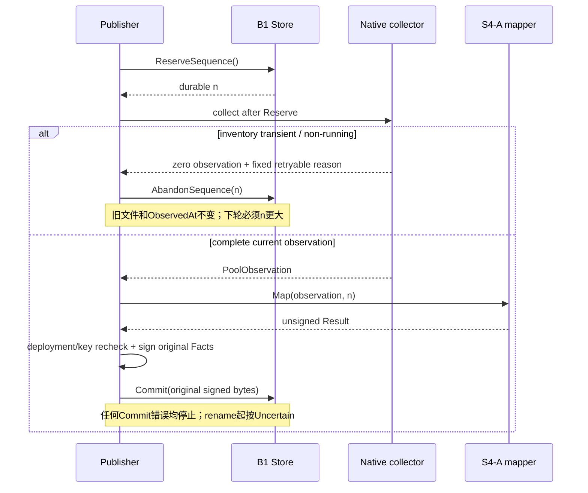

# S4-B2 native 采样、签名与发布衔接设计

_2026-10-20 · 设计候选，待审阅；未实施、未部署_

## 📋 建议与本次边界

建议完成一个 B2 源码切片：**固定 Linux running-pool collector → 现有 S4-A mapper → 私有 Ed25519 signer → 现有 B1 Store**，加上关闭生产启用门禁的受管命令与未部署 service 模板。不建立第二个预算、permit 或 Start owner。

这需要明确扩展 B1：增加 `AbandonSequence(ctx, expectedSequence)`，只废弃尚未进入 Commit 的已持久 pending 号，保留上一份 capacity 文件及原 ObservedAt。不扩大 raw v1/v2、PG、created-layer IPC 或资源保证。密钥与 B1 journal 必须分目录。

本设计请求的是源码及离线验证，包括新增受管进程的权限模板审阅；不授权安装/启用 service、CAP 实际授予、key/Trust/journal 初始化、Linux native 调用、VM/Engine/PG/Worker/provider 启动或真实环境验收。`verifyCapacityDeployment` 原样 unavailable；新 publisher 的部署验证入口也必须 unavailable，直到独立 host/native verifier 的后续设计与实现完成。不存在 env/CLI “临时放行”。`capacity_ready=false`、`execution_enabled=false`、`paid_consumed=false`，OpenSpec38/41。

## 🔎 当前源码依据与关键缺口

B1 的246项封存成员、931项当前输入及1737个 Git-visible 文件已在本设计新增前重新核验。当前来源冻结在18文件/45锚点记录 (private evidence retained)；下列是源码事实，后面的方案是建议，均不代表 Linux 实测。

| 当前事实 | B2 的影响 |
| --- | --- |
| B1 Reserve 有 pending 时 Busy；任何 Commit 错误 poison；Close 会撤下已识别的旧 publication | 采样失败发生在 Commit 前时，没有保留旧文件、永久烧号并继续下一轮的现有动作 |
| S4-A 要求完整 inventory，拒绝 created/paused/exited 等非 running 状态；原 PG freshness 为30秒 | 若每次遇到短暂 created 都 Close，会提前撤下仍新鲜旧样本；原 ReconcileCapacity 读失败会 block，可能干扰原 Create→quota→Start 窗口 |
| B1 private/public 都有有限叶子 allowlist | 私钥与 Trust/manifest 不能放进 B1 private/public 目录 |
| created Engine reader 只准 version/info/exactCID inspect；created parser 要求 created/PID0 | 不能扩宽它来做全量 running collector；原 observer、IPC 与权限职责保持独立 |
| created physical sampler 比较整个目录 metadata（含 ctime/nlink），路径只支持 upper | running 目录可能被正常写入；新 collector 复用有限 syscall/ABI，不能直接调用 created 专用整体 sampler |
| AdmissionManifest 只绑定结构和 digest，localproduct 的 host/native verifier 固定 unavailable | 有效签名或 receipt 文件存在都不激活保证；B2 不补一个返回 true 的“verifier” |

“Close 可能干扰 Start”是上述源码组合的推断，尚未实际复现。它是 B2 设计必须处理的衔接风险，不是宣称 B1 在其已批准离线范围内存在缺陷。

## ⚖️ 路径比较

| 路径 | 收益 | 代价与边界 | 结论 |
| --- | --- | --- | --- |
| **新增 Abandon，保留未续期旧样本** | 烧号、单 writer 和旧30秒时效都保留；短暂采样失败不主动删除旧文件 | 增加一个需要审阅的 B1 公共动作和并发/故障回归 | 推荐 |
| 每次采样失败 Close/Open | 不扩展 B1 API，代码较少 | Close 必须撤旧文件；若用它处理正常 created 过渡，可能更早令 PG block | 不作正常过渡策略；仍用于 fatal failure/shutdown |
| 复用同一 pending 号重新采样，或增加非 running raw 状态 | 前者不扩 API；后者能表达更多执行状态 | 前者改变已批准“采样失败也烧号”的约定；后者扩 raw/mapper/PG/Start 并改变保证 | 本次不采用 |

## 🔢 B1 新增动作的精确协议

```go
func (s *Store) AbandonSequence(ctx context.Context, expectedSequence int64) error
```

这是**新的待批准 API**。旧四个方法、journal96字节格式、路径、六个 sentinel、原始 raw v1 envelope、失败 Commit/不确定发布语义不变。

1. 与 Reserve/Commit/Close 共用私有 mutex，先检查 usable。nil/zero Store、nil ctx、expected<=0、无 pending 或 expected!=pending 返回 Invalid；closed 返回 Closed，failed 返回 StateUnavailable。错误参数不清 pending，也不让 failed 实例复活。
2. 合法参数下检查 context，再用既有 checkState 重验 canonical 目录、held lock、正式 journal 完整 bytes/inode 和当前 capacity 完整 bytes/inode。这里只读及关闭本次读 FD；不得 create/write/chmod/fsync/rename/unlink 正式或临时文件，不改旧 publication。
3. 任一 context/状态/IO 失败按既有 poison/fixed-error 规则停止该 Store，保留 errors.Is(ctx)，不宣称废弃成功；ctx 取消不能靠后台 goroutine继续操作。
4. 在最终 context 检查后，仅将内存 pending 置0、reservedAt 清零。high-water 和 sequence.bin 原样保留；成功后下一次 Reserve 必须取得更大号码。若在清零前/后 crash，重启都从正式 high-water 继续，expected 永不复用。
5. 已经调用过的 Commit 若失败，usable 检查拒绝 Abandon；Commit 成功则 pending=0，也拒绝。Abandon 不清 poison、不撤下/续期旧样本、不授权重签或重试旧 Commit，不发 permit。

并发中只能有一个方法完成状态动作；若 Commit 先成功或失败，Abandon 随后拒绝；若 Abandon 先成功，携旧号的 Commit 拒绝并遵循原 Commit poison 规则。匹配错误或重复 Abandon 必须有行为测试，不能只比较一个 bool。



## 🧩 模块与生产构造

只新增一个 collector 和一个发布编排，不抽象成通用采样框架或签名服务。

| 位置 | 新增职责 / 对外面 |
| --- | --- |
| capacityprobe | `PoolPlan` 值配置、`CollectPool(ctx, plan) (PoolObservation, error)`；仅固定 concrete Linux 来源；private finite backend 用于离线录制测试 |
| capacitypublisher | 新增 `Run(ctx) error`，生产无 options/filename/callback/signer/validator 注入；私有 startup/config/key/loop/signing；保留原 Mapper/Map 输入和行为 |
| capacitypublication | 只新增 AbandonSequence 及其回归，复用现有 journal/ownership 检查 |
| cmd/switchback-capacity-publisher | 只接受零业务参数，signal context 调 Run；不读 stdin，不接受环境 endpoint、Facts、fixture 或 key path |
| 新 service 模板 | 专用 guest 内独立进程，默认不安装、不启用，不改变 Backend/Worker/observer |

`PoolPlan` 只含 AnchorPath、Core（ID/CgroupPath/明确成员CID集合）和 Storage（ID/Path）；均来自固定 root 配置映射后的 Trust/bindings。它不含已观测 PID、quota 值、success/provenance 布尔或自选 syscall。Core/Storage各<=32，单组成员与全量 inventory<=32；路径必须在固定 `/mnt/lima-sbquota` 或固定 Switchback cgroup 子树内，拒绝根路径、重叠/重复/非 canonical/越界输入。Worker paths 仅由当前 inspect/proc 读取后严格派生。

production Run 先做平台/ctx、固定配置及结构绑定检查，然后调用私有 `verifyPublisherDeployment`。本片此函数固定返回 `publisher_deployment_unavailable`，在 key、Store、Engine/native IO 前拒绝。它不是独立部署验证器的替代实现；metadata 文件或“enabled”字段不能令它成功。内部编排测试使用同包私有 test seam，不暴露为 exported constructor、环境变量或命令参数；生产路径没有注入通道。原 localproduct verifier 与 PG 不改。

这明确意味着：本片交付可离线验证的完整候选链路和安全关闭的入口，不能声称生产 native publisher 已运行。后续独立 verifier 必须验证真实候选、当前身份、host backing、完整 source/mount/writer inventory、key/private目录可达性和 aggregate资源；其自身需要详细设计，不能在 B2 顺手用哈希校验顶替。

## 🌐 Engine 与严格解析

使用独立 fixed Unix reader：`/run/switchback-engine/docker.sock`。仅允许四类 GET：`/v1.56/version`、`/v1.56/info`、`/v1.56/containers/json?all=1`、`/v1.56/containers/<64 lowercase hex>/json`；不支持过滤、limit、aliases、转义CID、其他query或写方法。无 env socket/TCP/DNS/proxy/redirect/旧socket fallback，不使用 Docker CLI。单请求5秒、dial2秒、response header3秒、header/body各<=1MiB；总轮次另受25秒合作式 deadline约束。

Docker 固定版本 Swagger 明确采用1.56，`all` 默认false，且响应允许扩展属性；因此必须显式 all=1，不能把新增普通字段当错误，也不能因过滤漏掉非 running 容器。该规范访问不证明实际 guest Engine版本/包来源。[^docker]

JSON 先做全层 duplicate-key/单根值/尾随内容与大小检查，再对白名单所需字段做 required/non-null/exact-type 校验；允许并丢弃其他 bounded 属性，不保留/log Env、mount secret、Engine error body。整数以 int64 范围校验再转 uint64，拒绝负数、零（要求正数时）、溢出、float/exponent 替代和 null；布尔必须显式，PidsLimit不可空。Labels最多64项，key/value各<=512 bytes。

前后分别读取 version/info、完整 all-list及逐CID inspect。list去重、CID精确、<=32，不静默截断；按CID比较集合和全部安全相关投影，不比较无关动态统计。选取 ID、image digest、State status/Running/Paused/Restarting/Dead/Pid/StartedAt、labels、HostConfig CPU/memory/swap/PIDs/cgroup parent/privileged/network mode、GraphDriver/UpperDir。所有项必须被明确绑定为 core 或 Worker，不能漏项、拼造 Removal 或接受 unowned image。Mapper仍复核全部原契约。

任何非 running 状态使整轮无 Result；不把 HostConfig 数字伪装成 live cgroup。inventory变化/正常进程退出/非 running 作为固定 `pool_unstable`；身份、配置、权限、解析、quota不明与其他IO失败作为固定 fatal 类别。只允许对采样阶段的 `pool_unstable` 废弃本轮并按下述节奏再读，不盲重试不明确的签名、journal或Commit错误。

## 🐧 具体 native 读取

只支持 Linux amd64/arm64 little-endian；其他平台在 native IO 前拒绝。同包复用既有 LP64 ABI与 geometry/FSGETXATTR/QUOTACTL_FD有限读取，不修改 created-only 入口、原诊断collector、observer、IPC或ABI常量。读取是同步的，所有FD与buffer由当前调用持有；ctx不能硬中断卡住的quota/fsync，返回后才检查并拒绝晚到值，不启动 detached goroutine或提前close仍在使用的FD。

| 数据 | 本片必须实际读取与交叉核对 |
| --- | --- |
| 全局身份 | boot ID、self mount namespace、完整bounded mountinfo 前后相等；actual same-FD geometry UUID、fdinfo mount ID、device；不能statfs.Fsid→UUID |
| 目录 | Root、anchor、各storage、各Worker layer parent/diff；nofollow祖先walk，逐层root owner/无group-world write；held FD的stable inode/device/mount/type/mode/uid/gid及canonical reopen；geometry/FSXAttr前后；不以正常写入改变的ctime/size/nlink作running目录替换证据 |
| Anchor | 同一FD前后Fstatfs，块大小/总量/FS type稳定，计数先检查非负与overflow，保留两次available由原mapper取小；mount options为实际mount与superblock options有序union |
| Quota | 每个target的actual project ID来自该目录FSXAttr，worker parent/diff相等且继承；同mount FD读取QSTATV160、target112、default0原始112；保留原raw与三次实际sample时序，不把default0补成target；只GET不SET，inode hard=0仍是inode_bound_unproven |
| cgroup | held cgroup2目录FD前后device/inode/type；实际cpu.max、memory.max、memory.swap.max、pids.max、cgroup.type各<=128 bytes，前后完全复核，nofollower regular/control-file安全打开；值交原mapper，不能从inspect替代 |
| PID | 按inspect actual PID打开/proc对应目录，读取stat/cgroup前后；校验PID正数、start_time ticks稳定、StartTime字段不能从StartedAt推算。正确处理stat comm中的空格/括号；绝不读取environ/cmdline |
| namespace / 自身预算 | self与guest PID1的mount/cgroup namespace必须一致，boot/namespace前后不漂移；proc unified cgroup只接受0::canonical绝对路径，映射到实际/sys/fs/cgroup；worker必须在既有workers subtree，core members及publisher自身在Trust指定core subtree；cgroup2挂载root与当前namespace必须匹配 |

/proc提供start_time字段，但字段解析不构成原子process snapshot；需要inspect/proc/FD前后核对来检测普通退出/复用。cgroup namespace会改变/proc视图，不能直接从私有namespace拼出host路径。[^proc][^cgroup]

运行目录只比较稳定属性；project/xflags及reserved字段仍严格验证，不能因正常写入而放松quota或路径归属。所有有限read失败返回零Observation和固定错误，partial只在同包测试诊断中使用，不能送mapper或签名。采样时间必须取实际时钟，不为满足Ended>Started而补写时间；相等或回退时拒绝本轮。StateSamples<=64且不截断，每条 Source=linux_syscall/outcome/时间必须由实际调用产生；这个标签本身不证明native来源，真实构造和独立部署验证仍必要。

## 🔐 固定配置与密钥

| 目录 | 内容与约束 |
| --- | --- |
| 原B1 `capacity-publication-private` | 仍只准writer.lock、sequence.bin、sequence.next；不放key/config，不初始化 |
| 原B1 `capacity-publication-public` | 仍只准capacity.json、capacity.next；Backend未来只读挂整个目录，不bind单个文件 |
| `/mnt/lima-sbquota/core/capacity-publisher-keys` | root:root0700；唯一ed25519.seed，root:root0400、regular、nlink1、精确32 bytes |
| `/mnt/lima-sbquota/core/capacity-publisher-config` | root:root0700；只读root-owned bounded配置，包含trust.json、admission-manifest.json、publisher-bindings.json及现有reader的四个固定evidence siblings |

固定配置目录的七个叶子不能随输入扩展或选择path。既有 ReadTrust/ReadAdmissionManifest做结构/绑定校验前，B2额外安全打开检查root owner、nofollow、regular/nlink1/readonly、大小、same inode与目录canonical identity；不能把旧reader称为完整新密钥安全reader。

`publisher-bindings.json` 是独立 `switchback.capacity.publisher_bindings.v1`：只含schema、manifest_digest、core（原CoreContainerBinding的CID/image/CoreID）、worker_image_digest。未知/重复/空/越界拒绝，绑定exact Trust.ManifestDigest；worker digest须等于已有DeploymentInventory.WorkerImageDigest，core关系调用原NewMapper验证。新文件和unit/binary必须作为后续deployment inputs的一部分被真实verifier验证；单靠文件自报digest不产生authority，不扩现有AdmissionManifest/Inventory wire字段。

key reader在确认regular inode前不能data-open FIFO/device；沿B1同类O_PATH pin→owned self-FD reopen，精确读取32并检测第33字节、canonical/held identity/mode/owner前后相等。先检查长度再调NewKeyFromSeed，派生public key必须等于Trust与manifest。只使用plain Ed25519和既有SignatureDomain+原Facts payload，不改用Ed25519ctx/ph。[^ed25519]

私钥只存在publisher内存；不从env/stdin、HMAC、fixture、Task或Backend取值，不生成/轮换/修复key，不导出签名API、不发送key。签名前重读固定key身份与字节、确认与启动值相同；变化则fatal，不静默热切换。退出可清理owned buffers，但不承诺Go heap/OS内存被可靠擦除；不log私钥、seed hash、payload或完整错误cause。配置/Trust/bindings/evidence也逐轮重验字节及identity，改变即停止，不热rebind。

## 🔄 循环、失败与时效

循环单线程串行，不排队重叠。配置/部署验证成功后才读key、构造Mapper并Open B1。首轮立即开始，后续每轮结束后等待5秒；整个采样attempt为25秒合作式context，保留原mapper/B1/PG的30秒窗口和未来2秒容差，不能声称系统调用硬25秒返回。

每轮：确认配置/部署/自身cgroup→Reserve→新的实际Started→完整collector→Map(seq)→再次部署/key/时效检查→以原Facts序列化一次并签名→Commit原envelope bytes。ObservedAt沿用collector Started，不在签名或重试时改为now。最终Envelope<=原MaxBytes，B1再次Verify/CheckFacts，PG保持独立接收/记账。

| 结果 | 必须动作 |
| --- | --- |
| 非running或inventory transient，且尚未调Commit | 不生成签名；用service仍有效的parent context调用Abandon（不能用已过期attempt ctx）；确认成功后等待5秒、下一轮新Reserve/新采样。旧文件及ObservedAt不变 |
| Abandon失败 | fatal，Close尝试受约束清理并退出；不抹poison或重试Abandon成功声明 |
| 配置/identity/权限/quota/来源未知、mapper拒绝、签名或key异常 | fatal，烧号，Close并退出；不造partial成功，不退款/重建Worker |
| Reserve或任何Commit错误 | fatal；不再Reserve/Abandon/重签同号；Close结果不能把Uncertain改成未发布或回滚成功 |
| signal/shutdown | 等待当前同步调用返回后Close一次、清理owned key buffers、退出；无法硬撤销卡住的syscall/已消费permit |

Abandon只避免**主动提前撤旧文件**；它不证明Create→Start必然在30秒内完成，也不刷新原PG received_at。若created持续超时，旧样本自然失效；仍保留原CID/owner并走原reconciliation，不为恢复采样而盲Start、重复Create、生成Removal或放宽时效。真实窗口闭合必须由后续exact-candidate验收证明，失败则单独设计显式状态协议。

## 🛡️ 独立进程权限模板

建议新unit与observer分开，ExecStart固定为`/opt/switchback/bin/switchback-capacity-publisher`且无参数，无socket/request入口、User=root/Group=root、Slice=switchback-core.slice、CapabilityBoundingSet仅CAP_SYS_ADMIN、NoNewPrivileges=yes、RestrictAddressFamilies=AF_UNIX、RestrictNamespaces=yes、SystemCallFilter拒绝mount/reboot/swap组、Restart=no、UMask0077、LimitCORE=0、KillMode=control-group/TimeoutStopSec10s。子上限建议CPUQuota20%/100ms、MemoryMax128M/MemorySwapMax0/TasksMax64；纳入原Trust的core aggregate hard upper，不增加aggregate或Worker数值，不借瞬时idle。限制是否足够必须在目标候选实测，不因OOM自动加预算。

保持guest host mount/cgroup/user namespace；不加会改变namespace的PrivateTmp/ProtectSystem/ReadOnlyPaths/PrivateMounts/ProtectControlGroups/PrivateUsers选项。它们的作用不能只由名称判断，systemd明确多个filesystem hardening选项会创建mount namespace。[^systemd]

CAP_SYS_ADMIN在Linux v6.8 project Q_XGETQUOTA权限分支中需要检查，仍受LSM。它不是“只读quota capability”；固定GET/IO路径是受信任程序约束，不能防被攻破进程滥用其整进程能力或Docker socket权限。新publisher可以接触guest的固定Docker socket和root私有key/journal；本威胁边界只适用于专用受信任单用户guest，不防恶意guest root/持Docker控制权Backend。[^quota]

本次若批准，只写未部署模板，不执行systemctl、mount、capset、key provisioning或任何syscall采样。Backend三项文件能力与Worker seccomp过滤保持不变，observer不增加全量采样或签名能力。实际部署须独立授权并核验正常拓扑private目录不挂给Backend/Worker、public整个目录只读挂载；0700不能替代可达性证明。

## 🧪 实施范围与验收矩阵

建议按两个相依任务实施，但一次设计覆盖整个候选链路：先完成Abandon与concrete pool collector，再完成私有signer/loop/关闭入口与unit模板；每任务都做Spec/Quality评审，最后整片独立评审。不在本轮写实施代码或运行新增测试；批准后由writing-plans固定具体源码/命令/写入窗口。

| 文件范围 | 计划变化 |
| --- | --- |
| capacitypublication/store.go、store_test.go | 新增Abandon与公共行为/故障/并发回归；原codec/backend不改 |
| capacityprobe/pool_collect.go、pool_engine.go、pool_engine_decode.go、pool_native_linux.go、pool_native_other.go及各自tests | 独立全量入口、纯解析与有限native backend；保持原created/IPC/blocked collector源码 |
| capacitypublisher/publish.go、publish_config.go、publish_key.go及各自tests | 私有配置/key/候选loop与关闭的production Run；原mapper输入/output/raw语义不改 |
| cmd/switchback-capacity-publisher/main.go、main_test.go；新deploy/experience/switchback-capacity-publisher.service | 无参数命令/固定错误，未安装unit模板；不改Compose、现有unit或localproduct装配 |

以上路径相对唯一工作树 `/path/to/switchback`。不改raw v1/v2、admission manifest wire、PG预算/预留/permit/Start、Runtime资源数值、Worker/observer/IPC、已有生产门禁或既有证据。

| 验收 | 必须可观察的行为 |
| --- | --- |
| Abandon正例与restart | 发布n成功→Reserve n+1→Abandon→Reader仍返回原n同字节/原时间；下一Reserve n+2；重启不复用；Abandon不发生create/write/chmod/sync/rename/unlink |
| Abandon拒绝与并发 | wrong/repeat/nil/zero/closed/poison不清他人pending；每次state read故障/cancel均固定错误并fence；并发Commit/Close/Reserve语义明确，race单列 |
| Source parser/transport | all-list必须完整；缺字段/null/负数/溢出/dupkey/oversize/redirect/credential-canary/非法路径/写请求拒绝；忽略未知普通扩展；实际HTTP transport私有net.Pipe/本地fixture验证 |
| Native recorder | 每次有限syscall前后故障、晚到/取消、FD一次close；same-FD geometry/quota/statfs，canonical漂移/PID复用/namespace偏移/非running无Result；普通目录ctime/nlink改变不误报，project/mode漂移仍拒绝 |
| 完整链路 | 合法synthetic key/config与concrete协议fixture→Map→签名→真实临时B1→原Reader/Verify/CheckFacts；完整空Worker与一个Worker正例；创建态失败废弃号码保留旧sample且不续期，后续running新采样新号 |
| Key/config | 单独目录；32/31/33/64-byte、错pubkey、symlink/FIFO/nlink/owner/mode、替换/漂移/rotation拒绝；错误不泄露secret/path/seed hash；生产不可注入fixture/gate/keypath |
| Production关闭 | 即使文件存在或设置任意allow/enable env，实际Run仍在key/Store/Engine前返回deployment_unavailable；command无签名oracle或stdin路径 |
| 兼容与证据 | 新包+原capacity/config/localproduct定向回归，相关并发race单列；Linuxamd64/arm64只编译不执行。新功能先核验完整合法fixture，再执行真正行为RED；build-fail不计RED，失败尝试保留 |

实际Linux/XFS/LSM/服务能力、host backing/writer inventory、真实key隔离、kernel quota、断电及Create→same-CID Start30秒衔接，均保留给独立真实候选窗口。离线sample标签、录制backend、签名成功与cross-compile都不能关闭它们。

## 📍 审阅点与后续

请审阅三个决定：新增Abandon的有限B1扩展；独立collector/key目录/私有signer候选链路；专用CAP_SYS_ADMIN进程的未部署模板及生产关闭边界。批准后只进入上述源码和离线实施。实际部署验证器、service安装/启用、真实采样、S4-C和产品体验验收仍另行推进。

原B1初始完整fixture RED历史偏差继续保留。本设计只新增文档，不重写已封存报告、任务勾选或执行记录，不提交/暂存Git改动。

[^docker]: [Moby docker-v29.9.0 Swagger](https://raw.githubusercontent.com/moby/moby/docker-v29.9.0/api/swagger.yaml)，basePath/info版本、ContainerList all参数、Version ApiVersion及inspect定义；核验于2026-10-20，非实际候选运行证据。
[^proc]: [Linux v6.8 proc 文档](https://raw.githubusercontent.com/torvalds/linux/v6.8/Documentation/filesystems/proc.rst)，stat字段表。
[^cgroup]: [Linux v6.8 cgroup v2 namespace 文档](https://www.kernel.org/doc/html/v6.8/admin-guide/cgroup-v2.html#namespace)，namespace视图与路径关系。
[^ed25519]: [Go crypto/ed25519](https://pkg.go.dev/crypto/ed25519#NewKeyFromSeed)，SeedSize与NewKeyFromSeed、plain Sign；部署仍使用仓库固定工具链。
[^systemd]: [systemd.exec / PrivateMounts](https://www.freedesktop.org/software/systemd/man/latest/systemd.exec.html#PrivateMounts=)，当前文档解释namespace副作用，不是目标guest systemd版本验收。
[^quota]: [Linux v6.8 quota.c](https://raw.githubusercontent.com/torvalds/linux/v6.8/fs/quota/quota.c)，check_quotactl_permission与security_quotactl；target exact kernel/LSM必须另验。
