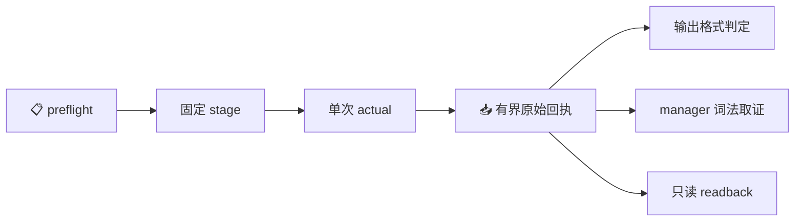

# M1 B3-E 诊断载体与离线执行候选设计

_2026-10-21 · 待用户审阅 · 接受后实施离线源码、回归与新 ELF 构建；真实窗口另行授权。_

---

## 🎯 目标与依据

让下一次诊断能在 manager 无法通过原 ownership parser 时，仍保留并解析 B3-D 的有限失败包，回答失败阶段、错误类别和最后 primitive 上下文。原 ELF exit 1 根因仍未知；本片不改变采集器或生产门禁。

当前证据已重新核验：B3-D 报告 (private evidence retained)、B3-C native 结果 (private evidence retained)。B3-D seal 的 134 项、B3-C 离线 seal 的 443 项及其 native seal 的 69 项均匹配；九份 B3-D 当前源码匹配封存。工作树 HEAD 为 `fbebfe754045bdbf1af40871a5018eed33743011`，index diff 为 0 bytes。

旧 guest 的 `actual()` 在解析 diagnostic 之前要求 authorizing manager 存在，旧 host 同样将成功 DTO 绑定到 manager。因此只替换 ELF 仍会在展开 filter/failed empty-cgroup 处拒绝，无法得到独立的结构化失败判定。B3-D 的 manager mapper 已明确 `authority=none`，可作为新只读取证投影。

| 路线 | 收益、代价 | 决定 |
| --- | --- | --- |
| 新诊断 carrier，独立解析输出，readback 无 unit 操作 | 直接服务失败定位；无需建立 systemd 策略等价或新 Stop 授权；代价是 unit/stage 保留，终止可能 unknown | 采用 |
| 同时完成策略等价、失败 unit ownership 与 Stop | 可恢复清理能力；需要额外版本规则、完整所有权链与更多安全回归 | 后续独立工作 |
| 只替换旧 carrier 的 ELF | 改动较小；原 manager 前置要求和旧失败协议仍阻断解析 | 不采用 |

## 🧩 边界与数据流

新增协议仅接受四个 mode：`preflight → stage → actual → readback`。旧 `post` 不属于新协议；readback 只读取固定 stage 的文件、固定 unit 的 show 与 fragment，不执行 Stop、restart、reset-failed、kill、remove 或任何其他 unit 操作。旧 carrier 保持原样。

guest 负责固定文件/命令采集；输出与 manager 的 mapper 均只在 host 运行。guest 不携带新的成功/失败 DTO parser，不携带旧 authorizing manager 或 Stop 路径，减少 guest bootstrap 大小与授权分支。旧传输、目录 FD、文件身份、挂载关联、X_OK、有限预算与独立 raw 保存逻辑以冻结 B3-C 源码为基线定向复用，不做运行时文本替换或修改导入模块的全局常量。

所有投影固定为 `kind=diagnostic_only`、`authority=none`、`execution_linkage=unproven`。`captured` 只表示原始结果已记录；格式合法的成功包也不把整个窗口标记为 native/deployment success。`remote_termination=unknown` 保持明确；不会从 failed、MainPID=0、空 cgroup、not-found 或客户端退出单独推导完整终止。

## 📦 离线构建与固定候选

批准后的实现目录为 `.scratch/runtime-m1-deployment-diagnostic-carrier-b3e-1021/`。现有 Go 源码只读，构建唯一新命令 `./cmd/switchback-deployment-diagnostic`：

| 项目 | 固定值或规则 |
| --- | --- |
| 工具链 | `/usr/local/go/bin/go`，当前核实为 Go 1.26.4 darwin/arm64；版本或工具身份漂移即拒绝 |
| 目标 | `GOOS=linux`、`GOARCH=arm64`、`CGO_ENABLED=0`；既有 native 回执 machine=aarch64，ELF e_machine=183；未来 preflight 必须重验 |
| 构建 | `go build -trimpath -buildvcs=false -mod=readonly -ldflags=-buildid= -o <固定候选文件> ./cmd/switchback-deployment-diagnostic`；不执行产物 |
| 依赖与缓存 | `GOPROXY=off`、`GOSUMDB=off`、`GOTOOLCHAIN=local`，私有 GOCACHE/GOTMPDIR，`GOMAXPROCS=2`、构建并发 2；不下载、安装或更改依赖 |
| 产物 | `artifact/switchback-deployment-diagnostic-linux-arm64`，完整 bytes/SHA256，ELF64 little-endian/machine183，最大 8 MiB；host 构建后只读 0400 |
| 新 stage | `/var/lib/switchback-deployment-diagnostic1021-b3e`，未来必须不存在；此时不创建 guest 目录 |
| 新 unit | `switchback-deployment-diagnostic1021-b3e.service`；只查询此新名称，不接触旧 B3-B/B3-C unit |
| 新 nonce | 批准实施后生成一次 canonical UUID，冻结到新候选及 source；不复用旧 nonce，不在运行时自动刷新 |
| 未来窗口目录 | `.scratch/runtime-m1-deployment-diagnostic-native-window-b3e-1021/`；本片不创建该目录或其实际 once marker |

离线 build receipt 记录精确 argv、允许列表中的环境、工具版本/哈希、go.mod/go.sum、参与构建的本仓源码清单、模块版本及构建前后输入一致性，并保存 `go version -m` 的只读产物元数据。只读核验已有模块缓存；缺失或不一致时停止该构建，不自动联网、修依赖或使用旧 ELF 顶替。这里不声称完成整个编译工具链的供应链证明。

新 candidate/release 明确绑定 B3-D source seal、B3-C carrier 来源 seal、这次新 build receipt/ELF、八份 Python source、nonce/stage/unit、完整 launch argv/property 和固定预算。不能延续旧 `artifact == legacy artifact` 的判断或改旧 PREP 令校验通过。guest source 和实际 bootstrap 编码都必须各 ≤65536 bytes；两份 host mapper 不进入 bootstrap。

## 🔒 执行意图与只读回读

未来 unit 沿用已接受的声明配置，仅路径/unit 身份改为新候选：User/Group root、CapabilityBoundingSet CAP_SYS_ADMIN、NoNewPrivileges yes、AF_UNIX、RestrictNamespaces yes、`~@mount @reboot @swap`、Restart no、UMask0077、CORE0、KillMode control-group、Startup10s/Stop5s、CPU20%/period100ms、Memory128MiB/Swap0/Tasks64、CPU2s/FSIZE32768。仍为 oneshot、RemainAfterExit yes、SuccessExitStatus2、stdin null、固定双文件输出；不增加 capability 或 `--wait/--pipe/--collect/--replace`。

这些是冻结的启动声明，不是已证明生效的 credentials 或策略。新 carrier 不建立 syscall 展开列表等价规则，也不把 B3-D 的词法分类传入授权判定。即使 manager 完整且健康，新 readback 仍然零 unit 操作。

沿用根设备 ext4 关联、root:root 无 group/world write 的祖先目录、逐级 no-follow、stage0700、guest ELF0500、输出/marker0600、exclusive 创建、before/after inode/device/owner/size/hash 校验、可用空间 ≥16 MiB，以及 flags 与 fixed-path/held-fd X_OK 检查。launch 准入与安全读取分开；readback 不因单独出现 RO/noexec 而绕过身份检查或转成写操作。

| mode | 总预算 | 结果与硬约束 |
| --- | --- | --- |
| preflight | 30s | 只读确认固定 VM 已 Running、host/guest/toolchain/config/source/platform、祖先与挂载关联、新 stage/unit 不存在；不启动 VM |
| stage | 45s | 未来授权后才 exclusive 创建新 stage/ELF/双输出/binding；相同设备、完整 ELF 和两种 X_OK 均通过才 staged |
| actual | 45s | host 入口先消费 host once；guest 取得有效 stage binding 后先消费 guest once，再重验 launch/新 unit 不存在；仅一次固定 systemd-run |
| readback | 30s | 只在完整 recorded actual/prior 连续时执行；重验 boot、source、candidate、stage、artifact 与 actual marker，重新保存双输出/show/fragment；零 unit 操作 |

每个 mode 使用独占的 host attempt 目录，失败或不确定后不重复该 mode；actual 消费后也不因拒绝、失败或取消重试。完整记录的 actual 可进入固定 readback；transport/capture persistence 不完整时停止后续 guest IO，不从未知状态重新取得实际执行或清理能力。旧 schema/nonce/prior 不接受，新 request version 固定 3；guest/host schema 分别为 `switchback.b3e.guest.v1`、`switchback.b3e.host.v1`。CLI 只接受上述一个 mode，不接受 VM/path/unit/command/env selector。

已有的有界子进程 pump 只终止自己启动的 transport/client 进程组；这不等于停止 systemd unit或证明远端终止。保留原 local-reaped、group-cleanup、remote-termination 等独立事实；所有 mode 都没有自动重试或额外探测窗口。

## 📤 原始采集与独立输出判定

guest 对 stdout 文件、stderr 文件、show 与 fragment 独立采集和保存；一项不可用不丢弃其他项。host 先持久保存完整原始 transport/guest envelope，再校验并投影。manager 或 fragment 不可解析不能阻断对完整双流进行输出格式判定。

文件读取上限：stdout32768、stderr4096 bytes，包含 LF；manager show/fragment 各65536；mountinfo1MiB；stage request12MiB。host transport stdout256KiB/stderr64KiB，以及既有完整性/总预算防线保留。超限、短读、文件身份漂移或不完整采集不能被当作完整包；保留已有有界 raw/metadata 与有限失败类别，不补全或拼接数据。双流不完整时 output_assessment 为空。

纯 host 函数 `assess_output(stdout: bytes, stderr: bytes, expected_boot: str) -> dict` 只消费完整 capture。结果固定包含 `schema=switchback.deployment.output_assessment.v1`、`kind=diagnostic_only`、`authority=none`、`execution_linkage=unproven`、`classification`、`expected_probe_exit_from_packet`、`sources`；格式合法时附带 `packet`。sources 含两份输入的 bytes/SHA256；无效时不返回部分 parsed 对象。

| 完整双流 | classification | packet / 预期 probe exit |
| --- | --- | --- |
| stdout 为严格成功 DTO v1，stderr 空 | `success_packet` | 原成功对象；依 namespace denial 推导 0/2 |
| stdout 为 B3-D 有限 failure v1，stderr 空 | `failure_packet` | 原失败对象；1 |
| stderr 为有限 failure v1 且恰为 write/write_failed、无 last_primitive | `output_write_failure` | stderr 的失败对象；1；优先于任何 stdout 形状 |
| 两流均空 | `missing_output` | 无 packet；预期 exit 为 null |
| 其余完整内容 | `invalid_output` | 无 packet；预期 exit 为 null |

只接受单个 JSON object 加一个末尾 LF；拒绝重复键、非有限数、未知/缺失字段、错误类型及超限。JSON 整数拒绝 bool。failure 字段集合、stage/class/primitive 枚举、last_primitive 的 stage 约束、errno1..4095 与现有 Go Validate 完全一致，不增加 raw error。可选 last_primitive/errno 使用固定 producer 的 omitempty wire 形状：缺省或有效对象/数值，不接受 null；不把通用 JSON→Go struct 的宽容解码自动扩展为 wire 契约。

成功 DTO 沿用冻结 v1 的字段/时间、boot、process、namespace、自一致性和固定新 cgroup 路径检查。只为格式验证从 packet 内取 caller PID、从 namespace 推导预期 exit；这两个派生值不作为独立执行关联证据。expected_boot 来自连续窗口 binding；failure 本身不携带 boot/PID，不补造这些字段。

`expected_probe_exit_from_packet` 是包内语义推导，不是观察到的 process exit。systemd-run return、raw manager ExecMainStatus、transport exit 与此字段分别保存。若 stdout 已写满但 Write 同时返回 error，B3-D 仍会发出 stderr write_failed；该矩阵必须判为 output_write_failure，不能据 stdout 合法便宣告成功。

manager 投影直接复用 B3-D `manager_forensics.py` 的完整冻结 bytes，SHA256=`cf7e424d6393a7dc2217f6e6c39d880786160b18789262f0f30ca2d23490974f`。host 按其既有有界错误契约记录不可用/invalid，不修改原 parser，不新增 policy_matches、owned、can_stop/can_start 或 termination verdict。

## 🗂️ 文件范围与精简方式

仅在新的实现目录新增八份 Python 文件；Go、B3-D/B3-C、旧 PREP 和其他当前输入全部只读。

| 文件 | 职责 |
| --- | --- |
| guest.py | 独立、可 bootstrap 的固定四 mode；复用目录/传输机制，移除 authorizing manager、成功 DTO 解析与 unit Stop 路径 |
| host.py | 新 source/candidate/prior/once 绑定、raw 持久保存与两个独立 host 投影 |
| output_mapper.py | 完整双流的纯格式判定与封闭 DTO 验证 |
| manager_forensics.py | B3-D 冻结副本，零修改 |
| test_guest.py | 内存 IO 下的路径、预算、消费、capture 与零 unit 操作回归 |
| test_host.py | 绑定、完整性、版本拒绝、持久化失败和无权威传播回归 |
| test_output_mapper.py | 成功/失败/写错误矩阵与严格格式/边界回归 |
| verify.py | 固定只读离线验证；不调用 native entry |

其余允许新增内容为该新目录内的 build artifact/receipt、source/config/candidate manifests、测试回执、评审、operation-window.md、报告与 seal，以及对应新实施计划/进度。保留依赖明确的 transport 代码，不为一次诊断新建通用执行框架；旧完整 verifier 可以只读复用，不整套复制历史测试为新数量。

## 🧪 离线交付标准

1. 对输出矩阵覆盖 stdout32768/32769、failure与stderr4096/4097、LF/重复/未知/缺字段/非有限/类型/errno/枚举、满写+error、stderr优先、空输出和不完整 capture。与现有 Go failure contract 的合法/拒绝样例对照，避免出现第二种可接受语义。
2. 用已保存的 B3-C actual/post manager 原文回放展开 filter、failed/empty-cgroup；用合成 B3-D failure 包验证 manager 不可用时仍可得到失败阶段。原失败窗口没有新 failure 包，不能伪造为这次 native 结果。
3. 四 mode 全路径证明无 unit 操作，包括完整健康 manager、失败、空 cgroup、不可解析和 missing output。readback 的正负例必须先建立有效 actual marker，证明拒绝没有被缺失前置条件遮蔽；记录到达的目标分支。
4. host/guest 双 once、先消费后 fresh admission、source/nonce/boot/stage/ELF 漂移、unit collision、取消、late error、incomplete transport/persistence、旧 schema/post 拒绝、预算/overflow/descriptor 与本地 process-group 清理均有可重复离线回归。不得通过重置 marker 测重试。
5. Native entry 的 AST/固定 argv 边界验证；所有行为测试只用 fixture IO。构建产物只读检查 header/hash/buildinfo，禁止执行新 ELF、native CLI 或真实 carrier mode。
6. 源码和候选独立评审；对新相关代码完成一次最终全量离线验证，修复后按覆盖变化重跑。所有1782个当前 Git-visible 文件、977项旧 current inputs、九份 B3-D 源及三个 seal 的646项 bound artifacts均保持原字节；新设计/计划作为明确登记新增文件。
7. 封存八份source、完整候选/ELF/build provenance、测试与评审回执，生成绑定具体 hashes/nonce/argv/预算的未来真实窗口清单。真实授权之前不创建 native window、guest stage/unit 或实际消费标记。

## 🔗 授权与后续边界

本设计若获接受，授权完整离线源码、fixture 回归、只读依赖/工具核验、唯一新 Linux arm64 ELF 的构建与证据封存。此刻仅有设计文档；没有新增实现、候选、nonce 或构建产物。

不包含 guest 进入、VM/unit 启动、capability 实授、Engine/PG/Backend/Worker/publisher/provider、部署 key/journal/quota/Trust 变更或资源数值调整。`capacity_ready=false`、`execution_enabled=false`、`paid_consumed=false` 保持现状；不暂存、提交、推送或改旧消费记录。

未来真实请求必须在本片全部验证/评审/封存完成后，绑定具体新 candidate、ELF、source、nonce、操作清单与当前 VM preflight，再由用户授权单次 actual。该请求会明确接受只读 readback、不自动 Stop、unit/stage 留存与远端终止可能 unknown。需要清理能力时另行设计和证明 ownership；旧 B3-B/B3-C 的 actual 永不重试，也不借本片接管旧 unit。
