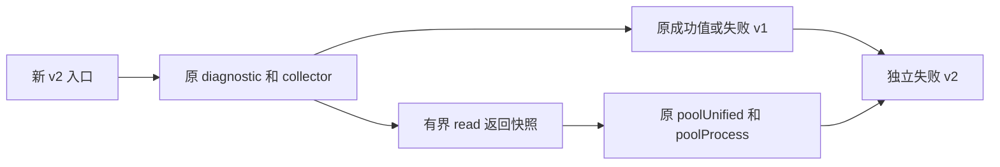

# M1 B3-G 进程解析检查诊断设计

_2026-10-21 · 待用户审阅；本片只包含新源码与离线验证，真实执行需新的独立窗口。_

---

## 🎯 目标和当前证据

B3-F 已消费唯一真实窗口：preflight、stage 通过，固定 ELF 实际退出 1；本地捕获完整，readback 未推进。失败包为 `observe / invalid / read pid1.cgroup returned`。原包只保留最后原语，没有 stat/cgroup 的解析结果；本次不能确定原生根因。B3-F 报告 (private evidence retained)、失败原字节 (private evidence retained)。

已有离线 overlay 证明：PID1 的零 start-time、cgroup 多行、空 cgroup 可以产生相同失败包；根路径 `/` 可通过。当前重新运行捕获回放仍得到 exit 1 和 capture_integrity=verified，这是原窗口失败的重现，不是新实现测试通过。原边界审计 (private evidence retained)。

本片交付独立的失败 v2 API、命令和纯 mapper，输出有限的**检查事实**。它区分读值长度、cgroup parser 和 stat/cgroup 联合 parser 的结果，不猜测实际根因，也不改变任何原校验的接受范围。

## ⚖️ 方案和取舍

| 方案 | 收益 | 代价与边界 | 决定 |
| --- | --- | --- | --- |
| 独立 v2，旁路复用原 parser | 不改旧源码/协议；不复制解析规则；无额外 native IO；能够分开本次三类夹具 | 增加独立入口；联合检查失败且 cgroup 检查通过只能缩小到 stat/PID 校验，不能直接报具体字段根因 | 推荐 |
| 重构 poolProcess，返回细粒度错误 | 可以直接区分 PID、字段数和 start-time 等分支 | 修改共享生产 parser 和已封存构建输入，影响池采集与旧 collector；需要另开兼容变更 | 当前不选 |
| 导出 PID1 stat/cgroup 原文或新增 guest 取证 | 对原生问题提供更多原始资料 | 改变数据披露或需要新的真实授权；不满足本轮离线边界 | 当前不选 |

本片不为一个假设放宽 start-time、cgroup 格式、namespace、身份或权限校验。后续只有新的原生证据才能确定实际故障分支。

## 🧩 复用和状态边界



新增导出入口：

```go
func ObserveDeploymentParseDiagnostic(context.Context) (DeploymentObservation, *DeploymentParseFailureObservation)
```

包内私有组合入口接收原 deploymentBackend，用于夹具。Linux amd64/arm64 的公开入口仍固定使用 deploymentLinux，在锁定 OS thread 后执行全部采集和清理，再解锁；其他平台返回 observe/unsupported。没有导出的 backend、路径/PID 参数、环境开关或可变全局 hook。

组合入口先校验 nil context/backend；不能用非 nil wrapper 掩盖 nil backend。它将捕获装饰器传给原 `observeDeploymentDiagnostic`，成功值逐字段保持一致。失败 v1 深拷贝转成 v2，LastPrimitive/Errno 不共享可变指针。原 collector、诊断 API、成功 DTO、失败 v1、共享 parser 和原命令均不修改。

装饰器嵌入并原样转发原 backend，仅包装 ids、openProc、openLeaf、read、close 来维护逻辑 owner 和本次读取状态。操作参数、返回值、error、调用顺序、FD 获取/close 次数不变；它不调用时钟、不再读 proc、不重试、不追加 native 操作。纯检查发生在原 collector 返回并完成原 cleanup 后。

每个 owner 仅有一个可替换的读取槽，caller 和 pid1 合计最多保存 16384 bytes：各自 stat/cgroup 每份最多 4096 bytes。空/超限读只保留形态，不保留超限内容。快照在 read 返回时复制，不输出 proc 原文、hash、PID、ticks、路径或 error 文本。固定 native backend 每次 read 返回独立 buffer；旁路事实只解释该次方法返回快照，不能证明外部输入或后续状态。

每次开始新的 status 读取尝试就先失效该 owner 的旧槽。槽记录私有 attempt 和读取顺序，stat 与 cgroup 必须属于同一 owner、同一次 process 尝试，并且 stat 先返回成功。FD 关闭删除映射，但不删除当前已复制槽；FD 复用、fd+late error、canonical 重开均不得拼接旧轮次。映射最多 16 项，超出时使后续 parse_checks 不可用，仍原样转发 collector。不存在磁盘 cursor 或跨调用状态。

## 📋 独立失败 v2

新增 `DeploymentParseFailureObservation` 和 `DeploymentProcessParseChecks`。旧失败 v1 的字段、schema 和 Validate 原样保留。

| JSON 字段 | 约束 |
| --- | --- |
| schema | 固定 `switchback.capacity.deployment_failure.v2` |
| kind | 固定 `diagnostic_only` |
| stage、error_class | 复用失败 v1 的封闭组合；通过构造旧类型调用原 Validate 校验，不另定义宽松集合 |
| last_primitive | 复用原类型、语义与约束；可省略 |
| parse_checks | 可省略；仅符合下面资格条件时输出 |

资格条件必须同时满足：stage=observe、error_class=invalid、last_primitive 为 read/returned，target 为 caller.cgroup 或 pid1.cgroup，errno 缺省；捕获槽的最后 read 与它匹配，stat 已成功返回 1..4096 bytes，匹配的 TID 已由原 ids 得到（pid1 固定 1），同一 process 尝试的 lineage 完整。取消、IO error、unsupported、编码/输出错误、缺槽或状态不明时省略 parse_checks，不猜值。

parse_checks 的键固定且仅有：

| 字段 | 值 |
| --- | --- |
| owner | caller 或 pid1，须与 last_primitive target 前缀相同 |
| stat_read | 固定 bounded |
| cgroup_read | empty、bounded、oversize |
| cgroup_check | not_checked、accepted、rejected |
| process_check | not_checked、accepted、rejected |

empty 表示返回零 bytes，oversize 表示返回超过 4096 bytes；bounded 表示 1..4096 bytes。empty/oversize 均不调用 parser。bounded 时，对真实捕获的 cgroup 调用原 poolUnified；对真实捕获的 stat/cgroup 和原预期 TID 调用原 poolProcess。丢弃返回的实际路径和 ticks，只保留检查结果。不得用合成 cgroup、替换 PID 或第二套 stat parser 来隔离错误。

Validate 只接受以下五个组合，其他一律 ErrDeploymentInvalid：

| stat_read | cgroup_read | cgroup_check | process_check | 可以支持的解释 |
| --- | --- | --- | --- | --- |
| bounded | empty | not_checked | not_checked | 返回值触发原 read 长度校验 |
| bounded | oversize | not_checked | not_checked | 返回值触发原 read 长度上限 |
| bounded | bounded | accepted | rejected | cgroup 单独检查通过；联合检查中的 stat/PID 校验拒绝 |
| bounded | bounded | rejected | rejected | cgroup 本身未通过；不能排除 stat 也错误，不能宣布其为首个根因 |
| bounded | bounded | accepted | accepted | 两项检查通过；原 collector 仍可能在后续纯内存身份比较中拒绝 |

禁止 process_check=accepted 而 cgroup_check=rejected。两个检查都 accepted 的失败必须可表达，否则会错误排除 canonical 重读后的身份漂移。新结果没有 root_cause、verified、owned、can_start/can_stop 或容量/执行授权语义。

失败 v2 的 Validate 校验上述资格、字段和组合；纯校验不接触 backend。它只验证 DTO 内部一致性，不认证来源。canary error/proc 内容及未知枚举不得进入合法包。

## 🔧 独立命令与纯 mapper

新增 `cmd/switchback-deployment-parse-diagnostic`，main 只绑定新公开 API；不替换旧命令，也不构建/部署新的 guest ELF。私有 run 可注入 observer 供离线测试。

输出约束沿用原命令：无参数、5 秒 context、成功 JSON 加 LF 至多 32768 bytes、失败 v2 加 LF 至多 4096 bytes。成功仍输出原成功 v1，不增加 envelope；完整成功退出 0，原 namespace EPERM/EACCES 成功事实退出 2，失败退出 1。参数/nil observer/矛盾成功失败组合分别走有限 entry 或 internal_invalid_result；编码、大小、写失败仍使用对应 stage/class。每 stream 至多一次 Write，短写或错误后只允许向 stderr 尝试一次固定 v2 write_failed，不重试。成功和失败的私有 runner 代码单独受兼容测试约束，不为了复用去改旧 sealed main。

新 scratch phase 内增加 `parse_output_mapper.py`，提供：

接口签名为 `assess_parse_failure(stdout: bytes, stderr: bytes) -> dict`。mapper 仅识别失败 v2；输入须为 bytes 且每 stream 上限 32768 bytes，类型或输入上限不符时抛固定 `ValueError("invalid_capture")`，不包含输入内容，也不计算超限输入 hash。单个可识别 v2 包（含可选 LF）上限 4096 bytes。拒绝重复键、未知键、非有限 JSON、类型混用和非法字段组合。恰好一边是完整合法 v2 且另一边为空时 classification=failure_packet；两边都有内容时 classification=ambiguous；两边都为空或单边非空但不是合法 v2 时 classification=unrecognized。正常返回保留两边的 bytes/sha256，并输出 kind=diagnostic_only、authority=none、execution_linkage=unproven。

该 mapper 不处理成功 v1，不验证 native 来源或采集完整性，不输出推进资格。本次不接入任何旧 carrier。B3-F 的真实 v1 失败包在新 mapper 中必须 unrecognized；旧 mapper 仍按原结果识别它，不能给旧包补造 parse_checks。未来新 carrier 必须独立设计成功/失败组合和 exact identity 绑定。

## 🗂️ 文件范围与保护

固定工作目录：`/path/to/switchback`。批准后新增以下 10 个源码/测试文件；不修改既有源码、依赖、部署配置或旧 scratch 文件。

| 新增位置（相对工作目录） | 职责 |
| --- | --- |
| internal/platform/capacityprobe/deployment_parse_diagnostic_types.go | v2 DTO 和严格 Validate |
| internal/platform/capacityprobe/deployment_parse_diagnostic_types_test.go | v2 组合、资格和数据泄漏回归 |
| internal/platform/capacityprobe/deployment_parse_diagnostic.go | 有界装饰器、同轮次检查与旧失败转换 |
| internal/platform/capacityprobe/deployment_parse_diagnostic_linux.go | 固定 native API 和线程锁定 |
| internal/platform/capacityprobe/deployment_parse_diagnostic_other.go | unsupported |
| internal/platform/capacityprobe/deployment_parse_diagnostic_test.go | synthetic 操作一致性与故障矩阵 |
| cmd/switchback-deployment-parse-diagnostic/main.go | 新命令与有限输出 |
| cmd/switchback-deployment-parse-diagnostic/main_test.go | 参数、固定绑定、退出、大小和写入回归 |
| .scratch/runtime-m1-deployment-parser-diagnostic-b3g-1021/parse_output_mapper.py | 无权限 v2 mapper |
| .scratch/runtime-m1-deployment-parser-diagnostic-b3g-1021/test_parse_output_mapper.py | 严格解析和旧 v1 拒绝回归 |

同一新 phase 可新增计划快照、输入清单、验证回执、报告和封存文件；批准后实施计划另存 docs/superpowers/plans。本设计是本轮唯一新增正式文档。当前基线为 1787 个 Git-visible 文件、458 个历史保护产物；HEAD=`fbebfe754045bdbf1af40871a5018eed33743011`、branch=`codex/observability-master-integration-1009`、index 为空。旧 B3-F source90项/执行82项已重新验证；新的材料不会写入旧 phase。保持现有 dirty worktree，不暂存、不提交、不推送。

## 🧪 验收与实际根因的边界

1. 本次三类夹具变为可区分的检查事实：零 start-time 为 bounded/accepted/rejected，多行 cgroup 为 bounded/rejected/rejected，空 cgroup 为 empty/not_checked/not_checked；根路径仍成功。增加同时 stat/cgroup 错误，证明不把 cgroup 检查失败宣布为唯一或首个根因。
2. 增加 canonical 重读后进程事实漂移：旧 collector 返回 invalid，但两项 parser 检查 accepted；不得误报 parser 拒绝。
3. 对原 success、namespace 预期拒绝、每个操作前/后故障、取消、fd+late error，比较新旧 API 的成功值、旧失败投影、原 backend operations、FD 数与 close 次数。证明没有新增 IO 或改变原接受/拒绝。
4. 验证多轮同 owner、caller/pid1 交替、FD 复用、canonical 重开、失败读、过长读、buffer 后续修改、槽覆盖、map 上限与取消；不串轮次，不泄漏 raw 内容，不因旁路缺失改写原 collector 结果。
5. DTO 的五个合法组合及所有非法交叉组合都覆盖；省略 checks 的普通 v2 失败合法，错误资格的 checks 拒绝；错误文本/proc canary 永不出包。返回指针可变对象不影响已生成结果。
6. 命令覆盖固定 API 绑定、0/2/1、nil/cancelled、矛盾返回、编码/大小边界、完整/短写/返回 error 和 stderr 失败；不执行 main/native observer。实际失败 DTO 使用最长合法组合验证小于 4096，不扩充协议来凑边界。
7. mapper 覆盖完整包、两个非空 stream、截断、超限、重复/未知键、bool/int 混用、未知枚举和不合法组合；B3-F 的 v1 原字节保持 unrecognized，原 mapper 的历史结果保持不变。仅用已保存本地输入。
8. 使用隔离的 Go cache/tmp、GOPROXY/GOSUMDB=off 运行新 Go 测试、原 deployment/pool parser 相关离线回归和适用 race；Linux amd64/arm64 只 compile-only，生成测试产物，不执行 native 入口、不构建部署 ELF。执行新 Python mapper 回归和原相关纯 mapper 回归；完成独立源码/契约评审，修复后做一次最终相关全量验证。
9. 回读本轮文件清单与哈希；既有 1787 文件和 458 历史产物均保持原字节，Git index/HEAD/branch 不变。旧 native window/once 保留，不创建新 native window。

离线验证能证明新检查事实的区分能力、兼容性和副作用边界；**不能从缺失的 B3-F 原始 proc 数据追认真实根因**。本片也不证明部署、容量发布、PG/Start 或页面交付闭环通过。

## 🔒 本次范围和后续入口

接受本设计只授权新增源码及上述离线验证。不进入 guest，不启动 VM/unit/Engine/PG/Worker/Backend/publisher/provider，不授予实际 capability，不初始化 key/journal，不修改 quota/Trust/资源值，不接生产 PG/Start 或 carrier。`capacity_ready=false`、`execution_enabled=false`、`paid_consumed=false` 保持现状。

B3-F 已消费且本地/远端清理状态仍 unknown，不重试、不续跑、不独立 readback、不发 Stop。本片完成后，下一项是绑定新诊断产物的 carrier/真实窗口方案，需新的身份、封存和授权；既有授权不会被本设计续期。
