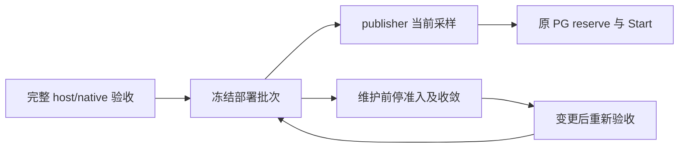

# M1 生产部署证明的有效期与职责设计

_2026-10-21 · 路线选择稿，待用户选择；未实现验证器、未改变生产准入_

---

## 🎯 建议与当前决策

建议 M1 优先选择 **A：启动前完整资格验收 + 冻结部署批次**，复用已有受信任部署配置和签名容量链路，不增加宿主常驻观察进程。前提是明确接受部署 owner 的运维责任：改变宿主存储/VM/候选配置前必须停止准入并完成既有权限收敛，再重新验收。程序不承诺自动发现批次内未经流程的宿主手工修改。

如果要求运行期间也自动发现宿主 backing 配置变化，则选择 B：持续只读宿主 witness。它需要新增 macOS 进程、有限事实传递、认证及失效协议，不能只靠 Linux 中两个函数的改动完成。自动探测仍受采样和传递延迟约束，不表示即时检测或撤销已发 permit。

本文只决定证明的有效期和职责，不选择或认可尚未证明的物理安全实现。两条路线均保留已批准 M1 的宿主 backing 安全、真实硬 quota、80% 记账和原 PG owner；没有路线可以把 APFS quota 数字、旧收据或 namespace 成功直接视为 C06 完成。

## 📋 已核实的当前状态

| 当前证据 | 结论 | 不能推出 |
| --- | --- | --- |
| 最新真实窗口，单次 launch；父/worker/probe 均 exit0；8 项 namespace 完整且前后稳定 | 本次 namespace 访问通过 | publisher 已部署或容量已可用 |
| publisher 生产入口固定返回 unavailable | 私钥、Store、collector 仍被门禁拦住 | 只需把返回值改为 nil |
| Backend 部署验证同样固定返回 unavailable | 原容量 source 组装仍受阻 | 现有 PG 已接受新环境 |
| admission reader 仅对四个证据文件校验 digest，并解析 inventory | 现有文件绑定基础可复用 | host/native receipt 已有语义验证 |
| publisher 与 Backend 的测试收据为 synthetic 或占位 JSON | 当前测试证明结构/关闭行为 | 已存在可消费的真实资格收据 |

源码入口：

- [publisher gate](/path/to/switchback/internal/workerruntime/adapter/capacitypublisher/publish.go:85)
- [Backend gate](/path/to/switchback/internal/localproduct/runtime_capacity_source.go:96)
- [manifest safe reader 与结构绑定](/path/to/switchback/internal/workerruntime/adapter/capacitysnapshot/admission_manifest.go:81)
- [publisher 配置、固定证据叶子与 core CID 绑定](/path/to/switchback/internal/workerruntime/adapter/capacitypublisher/publish_config.go:17)
- 真实 namespace 验证回执 (private evidence retained)

10 月13日历史记录包含专用 APFS 卷 reserve=quota=120259084288 bytes（112 GiB），但其自身明确写着 `capacity_proof=not_proven`。另有64 GiB raw datadisk 的历史挂载记录，不能据此推断所有未来写路径已覆盖。当前仅将它们作为重验线索。历史卷记录 (private evidence retained)、历史磁盘记录 (private evidence retained)。

本次对 `/Volumes/SwitchbackCore` 的普通宿主只读 `diskutil info -plist` 查询 exit1，报告 DiskManagement framework 不可用；没有取得当前卷事实，没有重试，也不据错误文本推断唯一根因。原始命令和结果保存在本片 scratch 的 `host-read-attempt.json`。

## 🔍 三条路线比较

| 路线 | 运行拓扑 | 宿主变化的处理 | 适用取舍 |
| --- | --- | --- | --- |
| A：资格验收后冻结，M1 推荐 | 保持现有进程拓扑 | 部署 owner 先停准入，再变更/重验 | 实现较小，依赖运维冻结 |
| B：持续只读 witness | 新增宿主事实进程与传递链 | 超时或不匹配时拒绝新授权 | 自动检测较强，协议与运维更多 |
| C：保持关闭 | 无新增链路 | 无生产准入 | 不接受 A/B 时保留安全状态 |

A 与 B 都必须真实验证独立存储边界及覆盖范围。Apple 文档将 reserve 描述为该卷保留的可用空间，将 quota 描述为该卷可分配空间的上限；APFS Reference 分别定义 reserve、quota 和已分配块数。它们说明机制的含义，不替代目标系统上的配置、写路径及执限验收。[^1][^2]

## 🧭 A 的精确运维合同

冻结批次是同一组源码/构建/部署输入、host 与 guest boot、VM、磁盘/文件系统、Engine、镜像/二进制、权限、挂载和资源配置的绑定，供部署验证器解释。它不是新 PG pool epoch、预算 owner 或 Task 授权对象。

1. 首次开启该部署之前，部署工具执行完整 host/native 资格验收，保留原始字节、实际命令/退出、输入与资源身份。任何未知项均拒绝生成正面的资格结果。已有 namespace packet 只能填充该次诊断的局部事实，不能补齐未执行的执限项目。
2. 原 admission manifest 的固定证据叶子承载通过详细设计的语义收据；不增加 `ready` 或 operator 自填 `approved=true`。root 配置的可信性和真实采集来源、算法判读是分别必须满足的条件。文件 digest 只负责绑定字节。
3. 启用后，publisher 继续每轮检查配置/自身身份，并采集当前 guest 资源与 inventory；Backend 的原 reader、PG freshness、reserve-before-permit 和 Create→quota→单次 Start 保留。冻结模型不允许停掉这些当前检查或延长30秒容量样本时效。
4. 宿主卷/磁盘映射、VM/镜像/构建、挂载/权限/预算、host或guest boot 等被冻结对象变化前，部署 owner 先停准入并按既有 owner/fencing 规则核实在途权限收敛；不以停 publisher 或过期文件单独证明所有在途执行已停。崩溃或变化发生后无法证明同批次有效时，由部署 owner 保持准入关闭。
5. 变更后重新验收。现有 `InitializeTrust` 的不可原地替换约束不变；如果结果改变已固定 Trust/manifest，必须遵循已批准的全新私有环境/DB或另行迁移设计，不能为维护方便 reset epoch 或清空旧账本。
6. A 不提供对宿主手工 quota/挂载等修改的持续自动探测；若 owner 绕过冻结流程，程序可能在该变化后继续使用原批次收据。接受 A 必须明确接受这个限制。它不能被描述为对任意宿主配置漂移均自动 fail closed。

## 🧩 两个入口的职责分离

建议以一个共享 module 集中证据安全读取、严格语义、候选 fingerprint 和拒绝原因；publisher 与 Backend 保留各自的 interface，不能相互复制整个判定链，也不能共享一个无角色的 `enabled` 布尔。

| 入口 | 必须回答的问题 | 本轮不能假定的能力 |
| --- | --- | --- |
| publisher | 收据是否真实有效绑定本批次；自身 core/namespace/能力和配置是否仍匹配；每轮实际采样能否验证 | namespace 成功不等于完整 quota/aggregate/私有目录证明 |
| Backend | 当前部署组装与受信任证据是否匹配；是否仍由原容量 owner 负责原子授权 | Backend 不是 host-native collector，不能为方便读取而新增 SYS_ADMIN/SYS_PTRACE |

Backend 内现有文件能力仍是 CHOWN、DAC_OVERRIDE、FOWNER；双能力仅属于已批准的专用 publisher/诊断进程。不能为共用 module 省事而给 Backend 增权。host 收据的生成、当前状态与失效语义必须在详细设计中独立说明，不能伪装成来自 Backend 的一次 native 调用。

## 🧪 后续整片交付与验收

选定有效期模型后，一次完成验证器详细设计，覆盖收据的严格字段/来源、canonical读取、host/guest/候选身份绑定、共享 module、两个入口的调用顺序与 bootstrap、失败/失效、兼容和离线回归。然后提交书面规格审阅，并据批准规格实施整片源码。

验收必须包括：真实合法 fixture 的正例；旧 namespace packet 单独拒绝；占位收据/同 digest 但语义不符拒绝；错 boot/FS/Engine/镜像/权限/私有目录覆盖拒绝；取消与读取漂移拒绝；两个入口不能由 env/CLI/fixture 放行；原 PG/Start owner 无替代路径；支持的平台编译与相关故障回归。不能用增加 DTO 或把 unavailable 改为 nil 作为完成标准。

实际 host/native 资格验收、密钥/Trust/journal 初始化、service 安装/启用、Engine/PG/Worker/provider 及生产门禁开启，仍只在具体候选与操作清单完成后单独授权。当前没有新的 guest 调用，旧 once 授权保持已消费；没有代码、配置、Git index 或旧封存修改。OpenSpec 6.5/8.4/9.3 保持未完成。

## 🔗 依据与待选择项

- [已批准 M1 保证](/path/to/switchback/docs/superpowers/specs/2026-10-19-m1-accounted-capacity-design.md)：宿主 backing 安全保留，guest 未来 metadata 风险已明确收敛
- [B2 设计](/path/to/switchback/docs/superpowers/specs/2026-10-20-m1-native-publisher-b2-design.md)：生产 verifier 必须独立设计，metadata 不授予执行权
- 最新证据封存 (private evidence retained)：99项；SHA256 `729a0f34b28f65d0a33d790c717bafa74d7492e94bb041670f10c5f284f6ee6a`

当前待选：是否接受 A 的运维冻结与手工变更不自动发现限制；否则改按 B 的持续只读宿主 witness 设计。本文尚未记录为 Accepted，也不授权任何真实运行或生产放行。

[^1]: Apple. “Add, delete, or erase APFS volumes in Disk Utility on Mac.” https://support.apple.com/guide/disk-utility/add-delete-or-erase-apfs-volumes-dskua9e6a110/mac
[^2]: Apple. “Apple File System Reference.” 2020-06-22，PDF 第54页：apfs_fs_reserve_block_count、apfs_fs_quota_block_count、apfs_fs_alloc_count。https://developer.apple.com/support/downloads/Apple-File-System-Reference.pdf
