# M1 冻结部署资格验证与生产组装设计

_2026-10-21 · A 路线已选定；本详细设计待审阅。本轮仅设计，未实施、未部署。_

---

## 🎯 结论、范围与成功标准

采用 **启动前完整资格验收，随后冻结部署**。不增加宿主常驻 witness。部署 owner 在改变被冻结对象之前，必须先停止新准入，并由原有 owner/fencing 链路核实在途权限收敛；运行程序不能自动发现绕过流程的宿主手工变更。这是用户在 `call_7e0063a29c6344f6b0608bce01e25db3` 选择的 A 路线，不是对任何现有物理机制的验收。[路线原文](/path/to/switchback/docs/superpowers/specs/2026-10-21-m1-deployment-proof-lifecycle-design.md)、原文字节快照与选择记录 (private evidence retained)。

共享 module 负责安全读取、严格收据语义及候选绑定；publisher 与 Backend 各自检查当前角色。资格验证只回答“此进程可以按哪组部署输入组装”，不能产生容量、permit 或 Start 权限。原 PG 是唯一容量授权 owner。

**当前关键路径是 C06 的宿主物理安全，而不是再造诊断 carrier。** 现有资料没有足够依据注册一个能返回成功的 host proof 算法。本设计明确这一拒绝状态，不以 operator 的确认、receipt 的 hash 或 namespace 成功替代它。下一阶段先完成 C06 的具体机制及证据核实，再形成一次完整的离线实现计划；不先实施一批仍只能关闭的 DTO 或 stub。

本设计完成的标准是：候选绑定无 hash 环；两个入口的职责可分别验证；启动不循环依赖；失败不会旁路原 PG；未支持的物理证明明确拒绝；真实验收和源码实施的边界可审阅。生产 verifier 的完成另须满足本文验收矩阵及 C06，不能因本文写完记为完成。

## 📋 当前事实与缺口

| 已核实事实 | 对设计的约束 |
| --- | --- |
| 两个生产 verifier 均固定 unavailable | 本轮保持关闭；不能直接改成成功 |
| admission reader 绑定四份证据的 digest，仅解析 inventory | 增加独立语义验证；保留 legacy 结构 reader 的兼容 |
| publisher 在读取私钥、打开 B1 Store、采集之前检查部署，循环与签名前再次检查 | 初次检查必须不依赖私钥、journal 或虚构的采样 sequence |
| Backend source factory 在 Reader/observer/InitializeTrust 之前检查部署 | 检查部署资格不能要求第一份 running snapshot 已存在 |
| CollectPool 要求完整 core inventory，包含已运行的 Backend | Backend 必须能在容量 stale 状态完成组装 |
| Backend 只有 CHOWN、DAC_OVERRIDE、FOWNER；无 host PID/proc 挂载 | 不共用 publisher 的 host namespace 检查，也不为复用而增权 |
| 原 PG InitializeTrust 将已固定的 Trust 视为不可替换 | 重新验收不意味着清账、换 epoch 或热替换 Trust |
| 最新真实回执只有 namespace 诊断通过 | 未证明 host backing、完整执限、私有目录可达性或产品体验 |

当前入口及原授权链：

- [publisher Run 与检查顺序](/path/to/switchback/internal/workerruntime/adapter/capacitypublisher/publish.go:43)
- [Backend source factory](/path/to/switchback/internal/localproduct/runtime_capacity_source.go:29)
- [结构 reader](/path/to/switchback/internal/workerruntime/adapter/capacitysnapshot/admission_manifest.go:81)
- [原 PG 初始化、采样与 freshness](/path/to/switchback/internal/workerruntime/adapter/postgres/runtime_capacity.go:36)
- C06 历史检查项 (private evidence retained)、[现行 M1 对 C06 的收敛范围](/path/to/switchback/docs/superpowers/specs/2026-10-19-m1-accounted-capacity-design.md)

旧 closure matrix 保留历史义务；以已批准的 M1 保证解释当前范围：guest 数据池未来 metadata 上界已退出，guest 系统盘风险仍必须局限于专用任务环境，宿主 backing 安全保留。不重新引入已移除的完整 guest metadata 数学证明。

## 🧱 Module 与 interface

共享 module 放在现有 `capacitysnapshot` package 的新 `deployment_qualification*.go` 文件中。这里已有安全 admission reader、strict JSON、Trust 和 digest 规则；保持这些细节在同一处，比另建 package 后公开 raw evidence bundle 或复制 codec 更简单。publisher 的 collector/mapper/signing 与 Backend 的应用组装仍留在原 package，不反向依赖它们。

规划的 interface 是：

| Interface | 行为与不变量 |
| --- | --- |
| `OpenDeploymentQualification(ctx, manifestPath, trust)` | 从固定 sibling leaves 重新安全读取；绑定 Trust、manifest、source/inventory、host/native 收据；语义及机制均受支持才返回私有字段 handle |
| `Metadata()` | 返回深拷贝的 manifest/inventory；它仍是 metadata，不是授权 |
| `PublisherBinding()` | 返回深拷贝的固定 core CID/image/CoreID 清单与 Worker image digest；publisher 必须与其已读取的 bindings 逐项比较 |
| `Recheck(ctx)` | 重新打开同一组目录和文件，比较身份、权限及原字节；检测到替换、漂移或取消即拒绝，不续期或重建 handle |

handle 不公开构造器、字段或 `Verified=true`；零值无效。它不导出 signer、任意文件 reader、Engine client、fixture loader 或 `allow` 参数。生产入口只能调用上述真实构造路径；测试 seam 限 package 私有使用。关闭 C06 时不能由内部测试替身穿入生产 factory。

publisher 继续使用既有 core binding/PoolPlan，并与 `PublisherBinding()` 返回的同一候选 binding 比较；返回值只含以上四个事实，不暴露 raw evidence 或 native DTO。规范化在共享 module 内完成，caller 拒绝任何清单差异。不能要求 Backend 学习采集器全量 DTO，不能把 publisherBinding 中的 outer manifest digest 纳入前置候选 fingerprint。

旧 `ReadAdmissionManifest` 与 `AdmissionManifestMetadata` 不升级为“已验证部署”。旧 raw v1/v2、签名 domain、GuaranteeRef、资源值、PG schema 和 created-layer IPC 都不改变。

## 🔗 候选、收据与无环绑定

### 候选 fingerprint

资格验收需要先知道候选，最终 manifest 又必须包含收据 digest。收据若反过来包含完整 manifest digest，会形成 hash 环。因此定义 `switchback.capacity.deployment_candidate.v1`，以固定字段次序和规范化整数/数组构造 UTF-8 JSON，再用现有 digest 函数计算 fingerprint：

| 字段组 | 规范化内容 |
| --- | --- |
| 固定契约 | schema、`m1_accounted_capacity_v1` exact ref、资源与网络 exact ref |
| Trust 的前置部分 | KeyID/PublicKey、Identity、AnchorPath、Core、Storage、Coverage；排除 ManifestDigest |
| 冻结输入 | SourceManifestDigest、DeploymentInventoryDigest；后者已绑定 DeploymentInputsDigest、镜像与二进制清单 |
| core binding | exact CID、image digest、CoreID；按 CoreID/CID 排序，拒绝重复与空集合 |
| Worker | exact Worker image digest；动态 Worker CID 不在冻结 core 集合中 |

Core、Storage、Coverage 按现有各自 identity 排序，拒绝重复、不明字段或语义不等的多种表示。不改变已有 Trust/raw 的编码；这里只定义新候选编码。PublicKey 使用现行 JSON bytes 编码，数字不用浮点数，时间不参与候选 hash。

两份收据都包含该 fingerprint，消费者自己重算。收据原字节分别进入最终 manifest 的 host/native digest；manifest 原字节再进入 Trust.ManifestDigest、publisher bindings 及原运行中签名/IPC 链。不得在收据中补写这个最终 digest。

```mermaid
flowchart LR
    accTitle: Acyclic Deployment Evidence Binding
    accDescr: 先固定不含外层 manifest digest 的候选，再生成收据和最终 manifest。运行时保持原 Trust、签名容量和 PG 授权链。
    candidate_inputs["源码、部署输入、Trust 前置字段、core CIDs"] --> candidate_hash["候选 fingerprint"]
    candidate_hash --> qualification["真实 host/native 资格收据"]
    qualification --> manifest["最终 admission manifest"]
    manifest --> trust_binding["Trust 与 publisher bindings"]
    trust_binding --> signed_sample["新鲜签名容量样本"]
    signed_sample --> original_pg["原 PG reserve / consume / Start"]
```

### 所有收据共同必须具备的语义

下面是资格收据的约束，不是可以提前生成的“成功示例”。host proof 的 mechanism-specific payload 只有在 C06 具体设计通过后才有正面解析路径。

| 字段组 | 必须验证的内容 |
| --- | --- |
| 版本和用途 | exact schema、lifecycle=`qualification_then_frozen_deployment_v1`、candidate fingerprint；未知版本拒绝 |
| 窗口 | 唯一 qualification ID、真实开始/结束时间，前后 host/guest boot 与相关身份；失败、超时、不完整窗口拒绝 |
| 生产者 | exact tool artifact digest、构建收据 digest、冻结输入 digest；对应 source/inventory；不能由 `source=native` 标签自证 |
| 原始事实 | 有界原始 bytes 及其 digest、固定 source ID、实际结果/errno/退出状态；不可只存摘要和 `passed` |
| 完整性 | 所需检查 ID 的 exact 集合；缺失、重复、未知、跳过、不确定均拒绝，不用成功项覆盖失败项 |
| 身份 | 与候选逐项绑定；所有前后观测必须符合该类检查的稳定规则；不能用不同窗口补齐一个资格证明 |

原始 payload 必须嵌入固定 receipt，不允许从 JSON 提供 path/URL 去读取附件。每个 leaf 保持现有 1 MiB 上限；超限失败，不截断。持久化证据前由实际 qualification producer 对大小作边界检查；不能为过测试删掉失败帧。probe 输出和非 secret 的身份可留存，私钥、环境密钥和完整 `/proc/*/environ` 不进入收据。

### 源码和构建来源

source manifest 新格式只接受固定 schema、排序的相对文件清单（path/类型/权限/字节数/digest）及构建收据索引。拒绝绝对路径、`..`、重复和 symlink 输入。部署输入清单必须覆盖实际渲染后配置，不能只 hash 含 `${VAR}` 的模板。

构建收据绑定每个实际 role 的输出二进制或镜像、所用 toolchain、exact 输入根和 artifact digest；source 输入树不含后生成的 qualification 输出、运行状态或 secret。loaded kernel/Engine 的身份另由 native 事实绑定，不把用户态 build receipt 当作它们的证明。已有 inventory/source 占位 JSON 只保留给旧结构测试，在新资格路径拒绝。

需要防止经由渲染配置间接成环：Trust.ManifestDigest、publisher-bindings.ManifestDigest 和 observer service 的 MANIFEST_DIGEST 都是最终 manifest 的派生值。DeploymentInputsDigest 使用固定 schema 的部署输入清单；只有这三个已命名字段用类型化的 `final_manifest_digest` 引用表示，不把其最终字符串 hash 回候选。对应实际字段必须在最终组装/资格读取中逐项等于 Trust.ManifestDigest，不能作为可随意忽略的路径或字段列表。其他 env、mount、镜像及渲染结果全部按实际值绑定；任何新派生位置先更新固定 schema，不能泛化排除规则。最终 manifest/Trust/收据不重新加入源码输入清单。最终实际配置原字节的 readback digest 保留为安装审计，不再作为自身的前置输入。

运行中程序不把“声明的 source digest 相等”描述为已重新构建验证。实际 producer、安装输入及运行中 loaded artifact 是三个要比较的对象。资格 producer 的执行及安装工作尚未发生，不允许事后人工填成 native 收据。

## 🗂️ 安全读取与冻结规则

固定叶子仍是 admission manifest 的四份 sibling evidence。Trust、publisher bindings 采用已有固定读取位置；新增资格验证不允许任务选择路径。

新 reader 在既有 root owner、不可写 leaf、canonical absolute、逐段 NOFOLLOW、regular bounded file 的基础上，保留目录和每个 leaf 的 device/inode/type/uid/gid/mode/nlink/size/mtime/ctime 与原字节 digest。打开前后、读完及路径重新打开后的身份必须一致；禁止用长期 FD 读到旧 inode 后声称路径未漂移。所有有限读取在 ctx 取消后停止。

Recheck 只允许同一批次相同字节及文件身份，正常的 capacity.json 原子发布不属于配置文件漂移；公共 snapshot 目录继续使用原 reader。配置重写即使 JSON 语义等价，也需要重验，不能在进程内静默换一套收据。目录身份检查不声称提供跨任意多个 syscall 的原子快照。

冻结包括 host/guest boot、VM 与磁盘映射、文件系统、Engine、core CIDs/镜像、构建/实际部署输入、挂载、能力、资源、私有目录可达性和维护策略。受原 PG/Supervisor 管理的正常 Worker Create/Start/Remove 是已批准动态行为；它们由固定 Worker profile、完整 inventory 和原 owner 检查，不要求每创建一个 Worker 就重新生成 core 资格收据。

## 🖥️ C06 的准入规则与下一步

### 保留的物理目标

任务专用 guest 的系统盘、数据盘及相关运行状态发生正常写入、失败或恢复时，不能把无界 backing 增长转嫁给既有宿主服务。证明范围包含 VM system/data/base image、Lima 状态、日志、cache、临时文件、COW/clone/snapshot 保留及实际 transport 写路径；同路径前缀或 TMPDIR 不是覆盖证明。guest 数据池自身未来 ENOSPC 风险仍按现行 M1 接受。

### 当前拒绝条件

尚无经过源码/官方机制及目标系统事实共同核实的 physical proof 规则可注册。因而 host mechanism 的生产支持集合当前为空：任何 host 收据，包括字节、版本和普通身份均正确的收据，都不能使两个生产入口返回成功。实现时不能加入 `operator_accepted`、`physical_safe=true` 或通用数字预算来填这个洞。

这不是收据有效期问题。10 月13日的 APFS reserve=quota=112 GiB 和64 GiB datadisk 是历史线索，记录自身为 `not_proven`；不能据此界定全部当前和未来 backing。Apple 说明 reserve 与 quota 的含义，但这些说明本身不证明本机完整 writer 覆盖及目标边界。[^apple]

### 下一片优先完成的实质工作

先提交 C06 的一份具体机制判定，包含以下六项；不先扩展生产 verifier 的成功路径：

1. 当前 host/VM/卷/容器/文件身份与实际所有 backing 写路径的只读清单；区分当前事实、历史值和无法读取的项。
2. 选定一种实际可执限的隔离机制，并给出其物理容量保证、计量单位及超限/恢复语义的官方或源码依据。
3. 对每个 writer 指明其被哪个实际限额约束，覆盖 cache/COW/snapshot/temp 与跨卷路径；缺一项即不能关闭 C06。
4. 用该机制可验证的事实导出物理边界，不捏造百分比、metadata 常数或“留一点余量”。不能导出则该机制不支持。
5. 定义固定 raw 格式与确定性 parser/判定规则，加入正反例；其输出仅为资格事实，无 PG/Start 权限。
6. 列明目标上的有限正反执限验收、新对象、退出和 unknown-effect 处理。任何写盘、挂载变更、启停或真实执限探测，待具体清单单独授权。

若当前机制不能完成以上要求，明确报告阻塞及最小可行替代，不靠继续改诊断器“推进”。本阶段不申请放弃物理目标，也不选择新增磁盘、重建 VM 或维护迁移。

## 🧪 Native 收据必须证明的范围

在 C06 规则确定后，完整资格 producer 还必须执行以下有限检查，保留实际输出，由纯判定逻辑重放；旧 namespace packet 不能拼接进新候选作为完整收据。

| 检查组 | 必须有的正反事实 |
| --- | --- |
| loaded identity | 实际 Engine、kernel/FS 特征、role 二进制/镜像、boot、FSUUID/device/mount 与候选一致；release 字符串不代替 loaded artifact 绑定 |
| namespace 与权限 | publisher caller-thread/PID1 各 namespace 可读且前后稳定，满足现行 collector 的 host 视图要求；dual capability/NNP/seccomp 是实际状态 |
| core 及资源 | 实际 core aggregate cgroup hard limits、各 role 归属与 inventory；publisher/observer 纳入同一 aggregate，不能重复扣费或遗漏 |
| byte quota | 相同目标内有限小 hard limit 的真实拒绝与足够 hard limit 的成功，池有余量；raw quota/state/FSXATTR/project inheritance 与真实对象一致 |
| Worker 防修改 | 已支持 ABI 的 FSSETXATTR/SETFLAGS 实际拒绝，GET/普通读写成功；project ID/继承标志不变。ABI 不可执行时记录实际原因，不填“通过” |
| Backend 文件能力 | 实际三能力/NNP；UID10002 的空/非空交接、私有目录及 sticky 清理正例，缺能力负例；不使用 ownership stub |
| 可达性与 writer | 从各实际 mount namespace 核对 source/data/Engine 与私钥、B1 private/public 目录；有限完整 writer inventory，无未知容器或新增外部写入口 |

0700 或配置中没写私钥路径都不证明 Backend 无法访问：其 DAC_OVERRIDE 可跨普通权限；必须检查真实 mount 拓扑。部署 owner/guest root/Docker socket owner 属受信任边界，本方案不承诺抵抗它们的恶意改挂载或伪造 native 观测。消费方验证输入来源和可重放判定，但不能由 JSON 独立证明现实调用曾发生。

真实资格 producer 的完整执行器是后续受授权的候选，不复用已消费的 once window，不启动 Agent/provider。其固定测试载荷、新 CIDs、实际写入和清理范围必须先有单独操作清单。

## 👥 两个生产入口的检查责任

### Publisher

初次顺序固定为：平台/ctx → 固定配置及安全读取 → qualification → 当前角色检查 → key → B1 Store → 原 publish 循环。

角色检查核对自身 loaded executable、实际 UID/能力/NNP/seccomp、boot 和 PID1 namespace、core 归属与 aggregate、配置/私有目录身份；复用有限 native 读取实现，不执行签名或保留 sequence。不能预先用 `sequence=1` 调 Mapper.Map，也不能以 `ReserveSequence` 的副作用来验证部署。

每轮仍按原 check → key recheck → Reserve → CollectPool → Mapper.Map(actual sequence) → check → key/window → sign → Commit。完整当前资源/inventory 由该轮 CollectPool 和 mapper 判断；资格收据不能预填 available。当前采样不完整时按既有 Abandon/停止契约处理，旧样本不续期。

初次 qualification 或角色拒绝，必须发生在私钥字节读取、Store 打开和 reserve 前；循环中拒绝不重写收据、不重发旧样本，也不新增重试 owner。

### Backend

Backend 只做静态资格和自己的可见角色检查：固定路径/Trust/候选、实际自身 executable、UID 与三项文件能力/NNP、可读的 guest boot。它不读取 guest PID1 namespace，不调用全量 quota collector，不增加 capability、host PID 或 host proc 挂载。

backend actual binary 必须与 inventory 的固定 backend role 比较；不能把自己的 namespace 当 guest host namespace，不能将 Engine inspect 的宿主 PID 与容器内 self PID 作数值相等判断。不可取得必需事实时拒绝组装，不从 container hostname 猜 self CID。core exact CIDs 的当前运行真实性留给 publisher 的完整 census 与原签名样本。

newInitialCapacitySource：配置检查 → OpenDeploymentQualification → 自身角色检查 → 原 Reader/observer → 原 CapacityStore → InitializeTrust。初始化把 pool 保持 stale；不要求 capacity.json 已存在，不制造启动样本。保留资格 handle，在既有 preflight 中于 ReconcileCapacity 前重新检查。检查失败直接阻断此请求，不允许降级到“上次资格有效”。

这些检查是资格与 advisory preflight，不是第二套授权事务。真正 reserve、consume、source pin、created-layer quota 和单次 Start 仍走原链路；不在锁内读文件或调用 Engine。A 的维护合同要求先收敛已有权限，因此不能把一次 Recheck 描述为对所有并发/在途 effect 的即时撤销机制。若需要程序化强制撤销整批权限，应另行设计，不能偷偷加一个 PG epoch owner。

## 🔄 启动、维护与失败顺序

### 首次组装，避免循环依赖

以下是未来操作顺序，不是本轮执行授权：

1. 所有生产门禁关闭。固定构建、渲染后的配置、镜像和目录；在任何新的写入/Engine 操作前，具体操作清单必须先核实已有物理边界足以覆盖这些准备动作，不能用未来收据倒授权准备写入。
2. 在该已批准边界内创建最终 core 容器并固定 CIDs、images、mounts、HostConfig；创建不等于 Start。由此封存不含最终 manifest digest 的候选输入，之后不再变更。
3. 在绑定该候选的同一 qualification 窗口中，完成完整 host 资格观测及预先批准的隔离 native fixtures，验证同镜像/配置的必要执限与权限；不得为了通过 Backend factory 而临时放行。结束一次性迁移/probe 后，完整 writer 清单不得漏掉残留者。窗口需重验 host 身份及物理边界；最终 role 的运行状态还要在后续 live check 核实。需要真实运行 fixture 的操作另行授权。
4. 将前置候选及完整 host/native 证据原子组装为最终 manifest/Trust/bindings。目录只读挂载整个配置目录；最终 Backend 的路径/镜像/HostConfig 不因填入这些字节而重建 CID。签名 key、B1 private、公有输出和 observer authentication key 分别归属，不能混放。
5. 按原依赖启动 PG/所需 core，再启动 Backend。Backend 可组装成功，pool 仍 stale，所有容量授权继续被拒绝。没有“先给一个 permit 启动 publisher”的动作。
6. 启动 publisher，当前角色检查和完整 core census 通过后发布第一份真实签名样本。Backend 按原 ReconcileCapacity 接受后，才可能由原预算与事务条件得到 ready。
7. Create → exact-CID quota → 原 PG 重验/consume → 单次 Start 的真实验收，以及报告/接受/同 Task 观测，分别在对应授权窗口完成。资格通过本身不打开付费入口。

第3步的 fixture 成功不能代替第5/6步对最终 role 的 live 检查。bootstrap 不依赖 Backend 的 HTTP ready 状态供 publisher 判定容器存在；Engine Running 和应用 ready 是不同事实。若 Backend 自身 factory 拒绝，不以 restart loop 或合成容量绕过。窗口内不同检查的 before/after 观测属于同一次有限资格操作，不授权重试旧 once window，也不能事后拼接其他窗口的成功项。

### 维护和失效

部署 owner 先关闭新准入，并由现有 Session/Run/runtime owner 核实未消费 permit、已消费 effect 和活动写入的去向；未知则保持冻结。仅停止 publisher 或等待30秒不能证明在途执行停止。

随后才允许改变被冻结对象，并重新进行完整资格验收。已固定 Trust 的变化返回原 identity drift；新 manifest/boot/Trust 需要现有约束允许的新私有环境/DB或独立迁移方案。保留旧 ledger/resident/Trace/数据，不 reset、down -v、prune 或复活旧 Session。崩溃重启后不能以文件仍在就自动认定仍处于同一冻结批次。

### 失败合同

| 失败 | 结果 |
| --- | --- |
| missing/legacy/placeholder/unsupported host proof | 资格 unavailable；两个生产入口保持拒绝 |
| 坏字段、digest、候选、source/role、boot 或读取漂移 | 拒绝该部署；不接受 partial、不回退到旧收据 |
| ctx 取消/读取超时 | 停止有限读取并返回失败；不继续 key/reserve/Start |
| publisher 当前采样不完整 | 沿用原发布/Abandon/关闭契约；不续旧样本 ObservedAt |
| 无第一份样本、读取失败、过期或签名错误 | 原 ReconcileCapacity 与 PG 拒绝容量；不以静态资格补值 |
| journal Commit 不确定、PG 不可写或 Start unknown | 保留原 owner 的不确定性和账本；不退款、重建或另发一次 effect |
| 绕过流程的宿主手工变化 | A 不保证自动发现；属于已明确接受的运维限制，不能报告“所有漂移自动 fail closed” |

错误返回固定阶段/原因，不回显 secret、原始任意路径或不可控 stderr。理由分类供诊断，不新建 Task/Worker 状态或 ready API。

## ✅ 验收矩阵与交付次序

| 层次 | 需要的证据 | 不能代替它的结果 |
| --- | --- | --- |
| 合同/codec | 完整合法合同 fixture；逐字段错、duplicate/null/unknown、超限、无环候选 hash、权限/替换/取消回归 | 占位 host/native JSON、仅增加 DTO |
| C06 | 选定且可实现的物理机制、完整 writer 绑定、raw parser、正反资格事实 | APFS 数字、df、历史路径或 namespace 成功 |
| 角色/组装 | publisher 在 key/reserve 前拒绝；Backend 无增权；源码无法注入 fixture/allow；bootstrap 无首样本循环 | 同包 orchestration seam 返回 nil |
| 原授权链 | 未发布/过期/错身份/错签名均零授权；同 CID quota 后单次 Start；unknown effect 保留；无新预算 owner | qualification handle、HTTP200、一次签名成功 |
| 平台/兼容 | 相关现有回归、Linux arm64/amd64 编译、unsupported 平台拒绝、legacy 字节形状不变 | 交叉编译当作 native 执限 |
| 最终环境与产品 | 真 host/native 资格、真实 publisher/PG、Create/quota/Start、报告/initiator 接受/刷新身份/同 Task 观测 | 单元测试总数、诊断成功或设计审阅 |

交付顺序明确为：**C06 机制与只读事实 → 完整资格 verifier/producer 的一次实现计划和离线交付 → 具体真实资格/部署窗口 → 原授权链验收 → 产品体验闭环**。不要再把 namespace 诊断的小修订作为独立主线反复推进。

后续实现应集中于新 qualification module/测试、两个既有入口的角色检查及 guard、对应离线组合回归和未部署资产。原 reader/codec 的兼容单列验证；不随手重构 PG、Start、raw formats 或 resource policy。具体文件清单和命令在 C06 规则明确后一次列齐，不在其未知时提前给出可放行的实现计划。

真实 host/native 收据尚不存在于本设计要求的完整合同下。当前生产支持状态仍为 unavailable，`capacity_ready=false`、`execution_enabled=false`、`paid_consumed=false`；OpenSpec 6.5/8.4/9.3 不关闭。旧106项 candidate seal、99项 execution seal、已消费 window 和原始 packet 均不修改。

## 🔎 本设计审阅边界

请求审阅的是 A 的上述共享验证、无环绑定、角色责任、bootstrap 和优先收口 C06 的交付顺序。本轮未写 verifier 实现，未申请注册一个未经证明的 host mechanism，也未申请安装、启停、写入 guest、初始化 key/Trust/journal、启动 PG/Engine/Worker/provider 或改变生产门禁。

已记录的 A 选择无需再次确认。书面设计审阅后，优先完成 C06 的实质判定；只有具体机制可验证时，才进入整片实现，避免用持续增加离线骨架掩盖当前阻塞。

[^apple]: Apple. “Add, delete, or erase APFS volumes in Disk Utility on Mac.” 说明 reserve 与 quota 的含义，不证明当前部署的完整物理边界。https://support.apple.com/guide/disk-utility/add-delete-or-erase-apfs-volumes-dskua9e6a110/mac
