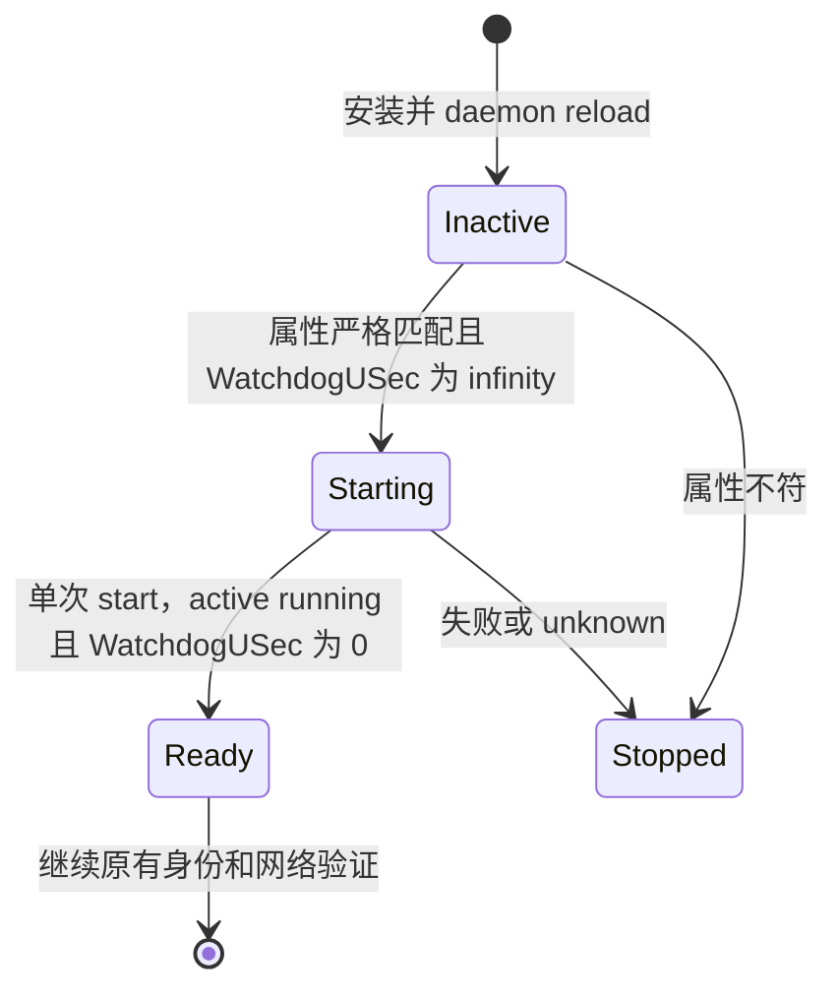

# M1 Engine WatchdogUSec 生命周期最小修订

状态：待用户审阅。当前只完成已授权窗口的本地证据收口与诊断，产品源码、模板、kit20 和 bundle1 均未修改。本文件不授权新的真实执行。

## 目标与已证明的错误

修正 `deploy/experience/engine/guest.py` 在首次启动前要求 `WatchdogUSec=0` 的错误，使严格部署检查符合实际生命周期。成功标准是实际 `_GuestOperations._effective` 能接受本次真实 inactive 属性，同时保留其他拒绝边界；就绪服务须验证 watchdog 确实关闭。Engine ready、Core 首启和完整任务体验分别验收。

本次准备、旧对象保留和四份新副本复制已成功；Engine 完成 claim、四文件安装及 daemon-reload 后，第一条 containerd unit 返回 loaded/inactive/MainPID=0/WatchdogUSec=infinity。真实输入已两次通过实际方法复现同一拒绝；只改变该字段就能通过第一条 unit。第二条 unit 尚无真实属性结果。

systemd 的 [初始化与 start 实现](https://github.com/systemd/systemd/blob/v256/src/core/service.c#L128-L158) 和 [D-Bus getter](https://github.com/systemd/systemd/blob/v256/src/core/service.h#L227-L230) 表明：getter 返回在 start 时保存的 original 值，新加载时为 infinity。[start 时赋值](https://github.com/systemd/systemd/blob/v256/src/core/service.c#L2485-L2498)之后，当前固定 unit 未配置 WatchdogSec，配置默认值为 0。这里以公开源码解释已观察行为，不宣称已经验证 guest 的精确 systemd 版本。

## 路线比较

| 方案 | 变化 | 取舍 |
| --- | --- | --- |
| A（推荐） | 启动前精确 infinity；active ready 精确 0 | 按生命周期校验，仍拒绝未知/有限值；无需新权限或额外 start |
| B | 启动前同时接受 0/infinity，其他不变 | 代码更少，但混淆新加载与曾启动的状态，且缺少 ready watchdog 证明 |
| C | 只给 unit 增加 WatchdogSec=0 | 改模板也不改变 original 字段的初始化，无法修复本次错误 |

## A 的精确源码边界

1. `_GuestOperations._effective` 的新安装、inactive/MainPID=0 分支仅将 WatchdogUSec 预期从字符串 `0` 改为 `infinity`，不引入宽泛 timespan 归一化或“任意值均关闭”的判断。
2. `_IO.daemon` 已在 containerd_ready、engine_ready、各次连接前后的 listener/process 身份收集内调用。在其固定 `show` 查询中增加 WatchdogUSec，并在 active/running/Result=success 的现有检查内要求精确 `0`。不在启动前尝试启动服务来取得该值；不增加新的动作、重试或 D-Bus 接口。
3. 四份固定配置、fragment、无 drop-in、ExecStart 唯一与完整 argv、依赖、root 权限、资源、listener/process/socket 身份、boot、时限和一次 start 约束保持。DTO 与 deployment receipt schema 不变；不修改 Go、PG/Trust/quota/Start、Native 权限或共享卷保证。
4. 缺失、空白、数字类型、非零有限值、错误状态或其他属性差异均拒绝；启动前的 `0` 不按本片解释为新加载成功。主动 ready 查询的 infinity 也拒绝。

图中的 Stopped 表示操作器停止推进，不表示已发送远端 Stop 或证明服务当前停止。

## 必需回归与整片离线交付

- 把本次 exact raw frame/哈希和四份实际配置作为真实输入回放，先保留 RED，再验证 GREEN。经 `_IO.show` 的实际属性 parser 驱动 `_effective`，而不是只测试复制出的比较函数。
- 覆盖两条 unit 的完整成功路径。第一条使用真实回执；第二条使用明确标注的固定配置派生 fixture，不伪称现场取证。验证其他属性、ExecStart/重复标量、fragment/drop-in、依赖、active/MainPID 变化继续拒绝。
- 用实际 `_IO.daemon` 和 listener 收集调用点覆盖 active=0 成功，以及 active=infinity/有限值/缺失/失败输出的拒绝；确认拒绝发生在后续 socket/API 连接和网络创建前。
- 保留原有 suite，最后代码状态执行相应 Engine/部署完整离线回归、候选 verifier、所有有限 guest 程序尺寸/时限检查。独立任务和整体复核，无未解决 Critical/Important 后封存。
- 因 Engine Python Source 变化，构建完整新 kit/bundle，重新绑定 Source/template 根、receipt 和候选。kit20/bundle1 以及本次 actual/seal 保持原样；不向旧 seal 塞补丁，不手改已安装文件。
- 同时完成新的离线准备操作清单：以本次 saved receipts 和 Root 本地 stage 清单为依据，保留当前 kit20 四副本、5002 叶宿主 stage、四份新安装 Engine 文件及 guest stage，保护已有所有 archives。当前 inactive/load 状态只属于当次回执，真实操作前仍须重新核验完整归属、unit/jobs、进程/FD/maps 和路径身份；证据不足不得推断无占用。

现有准备 guard 不因本片自动接纳 active/foreign/身份未知对象。若离线设计发现 loaded unit 等新状态必须扩展接纳策略，须把具体边界列入单独可审阅清单，不隐式放行或增加 maintenance/Stop。

## 本次建议授权范围

先一次完成 A 的源码、真实输入与生命周期回归、完整新候选、离线准备清单及独立复核/封存。这个阶段不进入 guest，不修改现有 host/guest 副本或安装物，不重跑 Engine，不初始化 PG/秘密，不读 key，不调用模型。

候选完成后再展示 exact manifests/seal 与真实操作清单，供最后确认新的单次真实窗口。原窗口已因失败结束，不能把旧授权当作重试许可。未来窗口仍不得启动 VM、改分区或调用 provider；成功须以真实 engine_ready 和资格 installed 回执证明。
