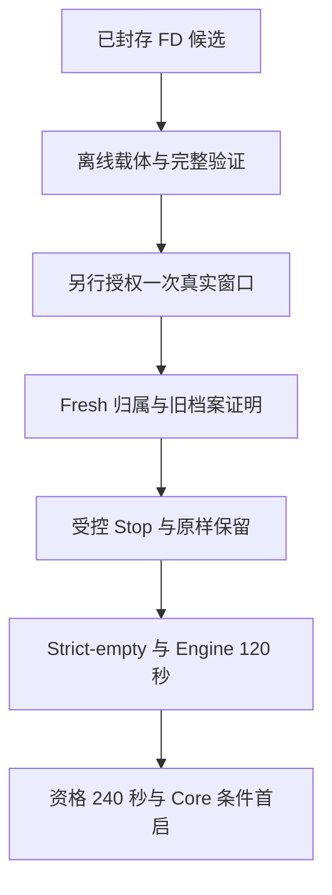

# M1 FD 生命周期候选的归属切换与条件首启

_2026-10-30；待用户审阅。接受本设计只进入完整离线交付，不授予真实环境权限。_

---

## 📋 已核实的出发点

正式 FD 采集修复已封存，当前 Source 与封存清单重新验核通过。候选质量不是本片的待解决问题；待解决的是把这个候选接到当前已发生过安装、启动的现场状态上。交付结果 (private evidence retained)

| 输入 | 固定绑定 |
| --- | --- |
| FD 交付 seal | `8a0291a492a24d8af2f752b1a42687a2c6509498e6283565b1ecc5aa453b690d` |
| 新 kit manifest | `a0efe562f7374bf104051b7cda706ed0bb621900a768a85ebfd46f4666566eb7` |
| 新 bundle manifest | `61bc3b24ff1a356d0fd7843af9982d7b68b9b467aa1dca7e653ac3b215154ed3` |
| 新 Source root | `sha256:81fac0053a7cbf98a4288ed55b3af7daaddc9f87f710983d430aef6b99ac2bce` |
| Templates root | `sha256:5280141c37f7152f1c00194955dba8614daec2514a681d5af826696bc89e89ce` |
| 成员闭包 | 1101 Source、7 templates、1176 kit members、27 bundle members |

新候选位于 `.scratch/runtime-m1-fd-lifecycle-1030/closing-owner-delivery/candidates/{kit-0001,bundle-0001}`；两个名字只在该私有目录中标识候选，不改称旧 kit25，也不覆盖历史目录。

最后一次实跑已完成旧对象保存、四份 kit25/bundle2 复制、安装和两条 Engine unit 启动；`networks` 的元数据采集失败后按约定停止。Native、凭据、镜像、新 PG、Core 均未进入。旧授权已消费，当前服务/网络存活未重新观察。失败回执 (private evidence retained)

本次设计取证重新核验了原始 37,533,587 bytes、45,196 frames、45,194 observations 及其流摘要。历史身份为下表；它们只用来约束未来 fresh 证明，不能当作当前存活事实。

| unit | 历史 PID / start tick |
| --- | --- |
| `switchback-m1-containerd.service` | `78372 / 141400509` |
| `switchback-m1-engine.service` | `78390 / 141400598` |

历史 boot 为 `751079a6-74a4-4570-bca6-18e460c7f33d`；六个 socket 与五个父目录、实际副本根身份及原始输入 hash 见 evidence-basis.json (private evidence retained)。最后一份完整 listener inventory 是正式校验前的观测；其 complete 字段也不产生新的 ready/Start 权限。

## 🔍 路线与必要变化

| 路线 | 做法 | 取舍 |
| --- | --- | --- |
| **A，推荐：完整归属切换载体** | 沿用已批准的归属证明→受控 Stop→原样保留→strict-empty→新 Engine→条件首启，重绑新历史代次与新候选 | 一次完整离线交付；最终审阅后只申请一次完整真实窗口 |
| B：先增加独立 Linux 采样诊断 | 先准备单独只读采样窗口，验证当前 Linux 的 FD/DIR 原语，再另做切换 | 更早取得 Linux 原语证据；增加一次单独窗口，不能直接证明 Core 首启 |

选择 A。复用 [原归属切换设计](/path/to/switchback/docs/superpowers/specs/2026-10-27-m1-owned-engine-transition-design.md) 的停止边界、manager/FD/maps/store/API 证明和 single-driver continuation；本片补齐三处已核实的接合点：

1. 旧入口绑定 `quiet_all_preserved_v1`，要求 source 缺失、服务 quiet，且禁止 Stop；它不能描述上次随后重新安装并启动的 kit25。新入口固定为本轮归属切换，不把新 source 与旧 archive 混作一项。
2. 旧 maintenance package 的 17 模块清单缺少 `fd_lifecycle`。必须把封存的 helper 放到 `guest` 之前装载，并为实际 producer/import 集合重新生成完整 hash、module、program 绑定。
3. 当前 Source FD 有七字段，旧私有 `owner_policy.FD` 严格为六字段。直接 `copy.deepcopy` 转发会被 `closed` 拒绝，需在私有 adapter 显式映射，而不是放宽 validator 或改公开协议。

四份实际安装文件 `containerd.toml`、`daemon.json`、两条 service 在旧 kit25 与新 kit 中 bytes/hash 相同。本片不修改 Source、模板、Go、正式合同或重建 20 个 Go 二进制；复用已封存的候选。

## 🔧 私有载体合同

### 当前对象与历史对象分开绑定

当前七个非空角色是 `/var/lib/switchback/m1-engine`、`/etc/switchback/m1-engine`、`/run/switchback-engine/m1-resident`、两个固定 unit 文件、`/opt/switchback/qualification-kit` 与 `/opt/switchback/engine-bundle`。独立 `/run/switchback-engine/docker.sock` 保持第八个可缺失的 socket 角色。

新固定归档代次：

- 宿主 `~/.switchback` 与 guest `/opt/switchback`：`archive-owned-engine-1030-kit25-to-fd`
- guest 另四个 parent `/var/lib/switchback`、`/etc/switchback`、`/etc/systemd/system`、`/run/switchback-engine`：`.preserve-owned-engine-1030-kit25-to-fd`

目标不存在才可创建/移动；0700 archive root、同 FS、nofollow、held parent、完整 node/hash/owner/mode/nlink、no-replace rename、每步重验与审计规则保持。宿主保存当前两副本和已消费 Engine stage。旧 archive 代次与全部 retained stage 原位保留并完整校验，不被新代次覆盖，也不作为待移动 source。

新观测必须完整覆盖当前/目标/旧 archive namespace。已知根 inode、mount、owner/mode 继续约束；旧维护完成后又被已证明部署动作改变过的 parent 子项/nlink/时间不能继续拿旧 all-preserved 的逐字节时间元组冒充当前状态。先用历史身份、完整允许 child 集和当前双样本建立新初始绑定，之后只按本窗口已审计的自有 mutation 重算预期，不泛化归一化外部变化。

旧 host stage 的新一代完整内容、guest 新 stage 的文件 inode/内容及尚无历史 FS 身份的节点，必须在未来同一窗口有界、双样本、完整读取并与已保存的 claim/outcome/frames 语义及真实 manifest/hash 对照；明确记录 first-observed。不得从历史 stage 名字推断当前 inode，也不得伪造静态文件清单或跳过未知文件。

### Source FD 到私有 DTO 的映射

输入字段严格为 `fd,target,flags,device,inode,mount_id,socket_inode`；输出仍是原私有六字段 `fd,target,flags,device,inode,socket_inode`。逐字段校验、复制原值；额外/缺失字段拒绝。`mount_id` 保留 uint64 含零语义，不通过旧 signed integer helper 截断或补值。

原始七字段事实及 Source/helper hash 必须保留在原审计链，映射事件绑定其 digest 与六字段结果。Source 自身的 pinned mount/inode/target/flags 完整验证先于映射，私有 validator 的关闭 schema、held-FD tuple、protected object/writer/owner/alias 规则保持。

维护仍调用原严格 owner 双样本；此 mapper 不新增维护重试。正式 Source collector 内已批准的最多两次元数据取样不扩成 service/API/Stop/NetworkCreate 重试。partial、历史及第一轮 prefix 仅能提供拒绝证据，不参与第二轮成功证明。

### 固定 Source 与装配

只在新私有 implementation phase 创建 carrier、mapper、布局、回归和绑定产物。Source module bytes 来自已封存候选；装载顺序包含 `contract/prepare/store/binaries/fd_lifecycle/guest` 及原私有模块的真实依赖，按实际 imports 验证，不增加环境/CLI 动态 selector。

六个 guest program、maintenance bootstrap/package、copy/launch/driver、archive/provenance/Source revision map 统一重绑新候选、新历史基础、新固定目标与新 disabled authorization。最终结果必须有完整新 binding；旧 grant/claim/end/maintenance JSON 不产生 continuation。授权 human/id/time/worker 字段为空、environment/provider=false；不创建可消费 actual claim。

若装配发现需要修改封存 Source/Go/模板、扩大权限/预算/路径范围或改变正式准入，先报告具体冲突；不能为打包通过静默修改它们。

## 🔄 未来真实窗口的固定顺序

| 阶段 | 固定条件与动作 |
| --- | --- |
| T0 | 新 driver/disabled artifact 完整验封；未来只有新明确授权才能 claim。VM 必须已 Running；不启动 VM。宿主副本、stage、writer/FD、parent、所有旧 archive、Source/候选重新证明 |
| T1 | 原 loaded/effective/typed ExecStop arrays、jobs、反向依赖/trigger、process/FD/maps、六角色 socket/parents、store v4、无业务证明全部重验。active 实例必须匹配上述历史 boot/PID/start/exe/hash/cgroup；换 boot/实例即停。自然退出仅按原 quiet/containerd-only 规则证明，不能凭同名接管 |
| T2–T4 | 仅对 initial 已 loaded 且被完整证明归属的目标，先 Engine 后 containerd，各 Stop 至多一次；原 typed owner proof、即时重验、KillMode/timeout、成功后预定义静止证明保持。未证明 quiet 不能移动 |
| T5 | 仅保存本轮当前对象到新代次；旧代次完整只读保持。残留 API socket 必须 exact inode/type/owner、无监听/FD 后才可保存。宿主当前两副本/stage 同窗完整保存；记录每次已发生效果 |
| T6 | 一次 daemon-reload，原未修改 strict-empty/manager/catalog/alias/FD/maps/store 检查通过；不能增加 loaded-unit 豁免 |
| T7 | 独占复制并完整验证新 host/guest kit/bundle 四副本；按 Source 原流程一次 Engine 120 秒，保留原两个固定网络与 bridge/NAT。网络状态未知不推断为不存在，不手工清理网络 |
| T8 | 仅 Engine 全部成功后，沿既定 Native 双能力、选择的 DeepSeek 私有引用、镜像/新秘密/新 PG/原迁移、资格→安装→Core 条件首启。没有 provider/model 调用或 Task 创建 |

| 预算 | 保持值 |
| --- | --- |
| 外层准备 | 7200 秒 |
| 维护 | 动作 100 秒＋本地收尾 20 秒，总 120 秒 |
| Engine / 资格 / barrier | 120 / 240 / 300 秒 |
| 每个实际 argv | 严格小于 65536 bytes |
| Maintenance frame / event | 16384 / 1048576 bytes |
| decoded / wire / journal | 128 / 192 / 192 MiB |
| ordinary / failure | 64 / 1 MiB |

现有底层 NODE/file/package/decompression/Source caps 全部保留。宿主与 guest 当前树、全部历史档案和新程序必须在真实输入规模下计费；原 9735 文件或前轮耗时不替代本轮 stage 的完整规模。离线 measurement 不能当作 Linux 时延保证；没有余量就不进入真实授权阶段，不加预算或省略历史义务。

首次失败、超时、身份/效果 unknown 或任一门禁拒绝即停止。只保留已有副作用与已读到的本地证据；不重试、续跑、自动回滚、失败后追加 guest 读回/Stop。成功动作后的既定后置证明仍属于原窗口。协作部署冻结模型保持，不能声称抵御绕过 owner 流程的其他 root 并发操作。

## ✅ 本片离线交付与验收

本片一次交付完整载体，不分拆成多个需要用户逐次批准的实现切片：

1. 从已核实输入生成新历史基础、固定布局与私有 mapper；原四安装文件等价、原始流及 FD 七→六字段边界必须可重复验证
2. 生成完整新 package/program/driver/copy/continuation/binding；全部 imports、实际 producer/member 集合、程序长度、Source 与候选互相绑定
3. 测试 active pair/containerd-only/quiet、实例漂移、业务/FD/maps/writer/store 拒绝、旧 archive 与新 source 共存、目标占用、Stop/rename/reload/ACK/journal/cleanup 故障；验证新 claim 一次性、旧回执无权续跑
4. 用真实历史输入规模与生产 parser/mapper/recorder/guard 做完整路径回放；合成未来状态明确标记，不直接 stub 最终成功。覆盖新 DIR 生命周期与 FD 字段映射的真实组合接口
5. 完整新候选对 Source/kit/bundle/模块/程序/disabled authority 的独立审计与复审，通过后封存，并提供唯一具体的新操作清单

本片不进入 guest、不操作宿主部署树、不启停服务、不生成 key/secret/PG，不读取凭据或调用模型，不改主盘/VM/存储、不写 Git index。必要的宿主真实数据读测若超出仓库内现有证据，将在最终操作清单中列为同一新窗口的 T0 前置证明；不能用历史或合成测量伪称已跑完。

当前审批只针对上述完整离线交付与归档/映射合同。后续真正 Stop、移动对象、读取所选凭据和启动环境，必须在最终完整载体可审阅后单独授权一次。环境通过后才进入真实 Task→正式报告→页面接受→同任务观测闭环，闭环通过后再做定向精简。
