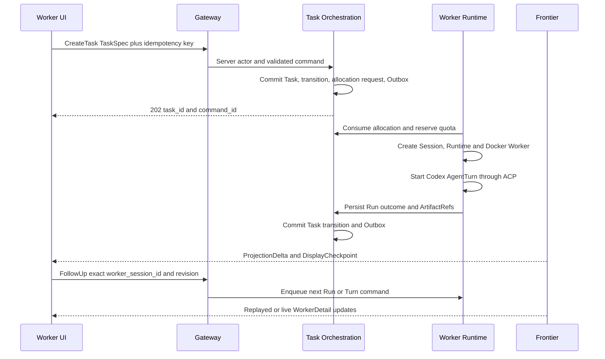

## Context

Switchback 当前拥有两类资产：一类是已经过长期需求澄清的 ADR、领域文档与协议；另一类是 `spikes/worker-runtime` 中通过真实 DeepSeek/Kimi 双 Turn 验收的执行实现。缺口位于两者之间：仓库还没有正式生产 Go module、PostgreSQL 业务状态、Gateway/Frontier 读写边界和 WorkerDetail 用户交互闭环。

本 change 从一个明确且已授权的 TaskSpec 开始，结束于用户可以观察真实 Codex 执行、审查 report/patch，并对同一个仍存活的 WorkerSession 继续交互。它不把 Assistant、Delivery、Evolution 或多用户鉴权拉进首个闭环。

M1 使用 SingleUserLocalProfile：Backend 固定 tenant/actor，Frontend 仅监听 loopback，但所有业务记录仍保留 `tenant_id`、`user_id`、`workspace_id`。执行环境继续采用 Backend 内 RuntimeSupervisor + Docker sibling Worker；Worker 内 root Shim 管理 LiteLLM 与 UID `10002` 的 Codex/Tool 进程。PostgreSQL 是业务状态与 Outbox 权威源，LocalFileObjectStore 是 Trace JSONL 与 Artifact 内容权威源，Langfuse 是可重建观测投影。

`refine-switchback-platform-design`、`AGENTS.md`、ADRs 0048/0049/0050/0051/0055/0058/0059/0061 和 `docs/contracts/core-protocols.md` 继续提供领域约束。本 change 只选择其中形成第一个可运行纵切所需的子集。

## Goals / Non-Goals

**Goals:**

- 建立正式 DDD 模块和单一 `switchback-backend` composition root，而不是把 Spike 目录改名后直接发布。
- 从直接提交的 TaskSpec 幂等创建 lightweight Task，分配 WorkerSession，并在 Docker 中执行真实 Codex。
- 持久化 Task、Session、Run、Turn、Runtime、Transition、Outbox、projection cursor 和幂等结果。
- 保持每个 WorkerSession 只有一个顶层 active WorkerRun/AgentTurn，并提供稳定 FIFO。
- 通过 Gateway command/query 与 Frontier snapshot/SSE 提供 WorkerDetail 主交互面。
- 展示阶段进度、report、patch、waiting-user/approval，并允许 exact live Session 后续 chat、queue、interrupt 和 capability-gated steer。
- 让 Backend 重启后可以从 PostgreSQL 与 ObjectStore 恢复用户可见状态，不依赖 Langfuse 或内存对象。
- 保持 Spike 已验证的 Docker、ACP、LiteLLM、Trace/Artifact、secret 和 cleanup 不变量。

**Non-Goals:**

- Assistant clarification/readiness UX、飞书 Delivery、Evolution/Truth、OpenViking、Inspiration 或 Skill Market。
- SSO/OIDC、动态 Membership/RBAC、多用户 session 和公网部署。
- Runtime generation 自动恢复、gRPC transport fallback、完整 Linux egress enforcement、PreviewProxy 和 managed SessionProcess。
- 自动 GitHub push、分支发布、ChangeSet Apply、生产/外部平台写入，以及受保护 effect 获批后的同步 Tool resume bridge。
- GraphQL、RocketMQ、Kubernetes、MongoDB、GitLab 或 Jenkins。
- LiteLLM sidecar；该拓扑只作为独立限时实验。

## Decisions

### Decision 1: Use one modular Backend for the first production slice

正式代码采用一个 Go module 和一个 `switchback-backend` deployable，内部按 bounded context 分成：

```text
cmd/switchback-backend
internal/taskorchestration/{domain,application,adapter}
internal/workerruntime/{domain,application,adapter}
internal/artifacttrace/{domain,application,adapter}
internal/eventingprojection/{application,adapter}
internal/gateway/{http}
internal/frontier/{http,sse}
web/worker-ui
```

依赖方向为 adapter -> application -> domain；infrastructure 实现 application/domain ports。Task Orchestration 不导入 Docker/ACP，Worker Runtime 不改写 Task aggregate，Frontier 不读取 Worker 内存。

选择它是因为当前风险是协议与 ownership，而不是独立部署伸缩。一个 modular monolith 可以先获得 PostgreSQL 事务、Outbox 和清晰边界，再按真实压力拆服务。

备选方案：立即拆成 Gateway、Task、Worker、EventCenter 多服务。它能更早验证网络边界，但会在没有稳定协议时增加分布式事务、部署和调试成本，因此延后。

### Decision 2: Promote contracts before adapters

实施先建立 promotion matrix，把 Spike 组件标记为：

| Spike 资产 | 决策 | 正式归属 |
|---|---|---|
| ACP adapter/raw tee | adapt | Worker Runtime adapter |
| Docker provisioner/path derivation | adapt | Worker Runtime infrastructure |
| WorkerControl proto | adapt | Worker Runtime interface |
| Trace/Artifact finalizer | adapt | Artifact & Trace application |
| Langfuse exporter/verifier | adapt | Artifact & Trace projection adapter |
| LiteLLM callback/model profile | promote with tests | LLMProxy runtime adapter |
| in-memory run state | discard | PostgreSQL repositories |
| Harness HTTP API/summary | discard | Gateway/acceptance tests |
| fault proxies | retain as test support | integration test infrastructure |

正式协议保留 TaskSpec、IntegrationEvent、Trace JSONL、ArtifactRef、AgentProfile 和 WorkerControl 的 identity/provenance，不直接暴露 Spike summary 或 Harness 字段。

备选方案：先复制实现再重构。它更快出现代码，但会让临时 state owner、路径和 timeout 变成事实标准，因此拒绝。

### Decision 3: Keep business state, evidence, and observability separate

- PostgreSQL 保存 Task/Session/Run/Turn/Runtime 当前状态、Transition、Outbox、idempotency、queue sequence、projection state 和 Artifact metadata。
- LocalFileObjectStore 保存 raw/normalized Trace JSONL、manifest、report、patch 和其他 Artifact 内容。
- Langfuse 保存 Trace/span/generation 派生投影。

一次 AgentTurn 只有在 terminal state 与 Artifact/Trace refs 已提交后才可向 Task 汇报阶段结果。Object upload 使用 checksum、幂等 object key 和 finalize manifest；数据库只引用已验证对象。Langfuse export 失败只影响 observability projection，不改写 `execution_outcome`。

Truth 和 ContextPack 在本 change 中不加载。TaskSpec 可以保留未来 context refs，但 M1 prompt compiler 只使用 immutable TaskSpec、Workspace metadata 和当前 AgentSession context；不得伪造 Evolution Truth。

备选方案：把 JSONL 全存 PostgreSQL，或把 Langfuse 当事实源。前者放大数据库负载，后者无法提供 Switchback 所需的持久 schema、权限和重放控制，因此拒绝。

### Decision 4: Make Task creation and allocation separate transactions

直接 TaskSpec 请求先进入 Task Orchestration：

1. Gateway 注入服务端固定 actor/tenant，并校验 idempotency key。
2. Direct-create policy 对 exact TaskSpec 生成 zero-question TaskReadinessAssessment；只有无 `blocking_unknown` 时才记录绑定 actor、TaskSpec digest、Workspace 与 policy revision 的 ExplicitTaskCreationIntent。
3. Application service 重验 creation intent、TaskSpec schema、显式 `workspace_id`、WorkspaceRevision 与服务端 AgentProfile。
4. 一个 PostgreSQL 事务消费 intent 并创建 Task、初始 TaskTransition、Task-owned SessionAllocationRequest 和 owner-stream Outbox。
5. WorkerSessionAllocator 独立消费 allocation request，在 quota/FIFO 事务中创建 `allocating` WorkerSession。
6. Runtime owner 创建 RuntimeInstance，建立 WorkerControl，获得 execution slot 后创建 WorkerRun/AgentTurn。

Task 创建事务不进行 Docker、模型、对象存储或网络调用。Intent/Task 创建使用稳定 direct-create intent key；响应丢失时，同一 idempotency key + TaskSpec digest 返回原 Task identity，digest 不同则返回 conflict。直接 API 省略的是 Assistant 澄清回合，不是 readiness 或创建授权证据。

备选方案：Gateway 请求中同步创建容器。它会让数据库锁持有网络副作用，并使 timeout 产生重复容器，因此拒绝。

### Decision 5: Preserve lightweight Task and WorkerSession-primary interaction

Task 状态固定为 `queued`、`running`、`waiting_user`、`delivered`、`completed`、`failed`、`cancelled`。Task 只保存 immutable TaskSpec snapshot、initiator、Workspace、current Session/Run、result refs、`acceptance_mode`、status 和 revision。

WorkerSession 是主要交互面，同一时刻最多一个 active WorkerRun 和一个顶层 AgentTurn。patch 默认 `manual`：阶段结果进入 `delivered`，用户 accept 才完成；用户在 Task 尚未终态时要求修改会在同 Task/Session 下创建新 WorkerRun。Task 终态后的 direct chat 创建无 `task_id`、可带 `origin_task_id` 的 standalone WorkerRun。

复用现有 Session 必须携带 exact `worker_session_id`；普通新 Task 默认申请新 Session。closed/expired Session 不复活。

备选方案：让 Task 成为完整 workflow/saga 主界面。它会复制 Worker 的运行与交互状态，并重复用户此前要求简化的流程，因此拒绝。

### Decision 6: Use durable PostgreSQL scheduling with fixed M1 policies

M1 实现以下服务端固定策略：

- WorkerSession continuity quota：每个固定 tenant/user 为 10。
- Session allocation：稳定 FIFO；满额时 Task 保持 `queued`。
- Session execution：稳定 FIFO；不支持 priority、reorder 或 preemption。
- AgentTurn hard deadline：从 Backend 接受 dispatch 起固定 24 小时，任何等待均不暂停。
- Session idle：48 小时；有效 chat/command/OpenPreview 语义动作才刷新。
- Session absolute lifetime：14 天，不暂停、不延长。
- Runtime residency：`interactive/running/waiting_user/idle` 保持同一 generation 1 Runtime。

poller 使用 `FOR UPDATE SKIP LOCKED`、短 lease、fencing token、expected revision 和幂等 command。它只提交 application command，不直接执行 Docker 或其他副作用。

本 change 不实现 generation recovery。Runtime 丢失时 fenced 后保留证据，Run 终止，Task 进入可解释的 `waiting_user` 或 `failed`，不得静默创建 replacement Runtime。

备选方案：第一版只用内存 timer。它无法跨 Backend 重启证明 24h/48h/14d 语义，因此拒绝。

### Decision 7: Keep Runtime provisioning server-owned and Spike-equivalent

Backend 内 RuntimeSupervisor 是唯一 Docker owner。Worker 不挂载 Docker Socket、不使用 privileged/host network/host port，也不接受客户端宿主路径。mount source 只能从服务端 Switchback data root 和 WorkerSession identity 派生。

Runtime 使用固定 `local_standard_v1` 资源 profile。Worker root Shim 启动 LiteLLM UID `10001` 与 Codex/Tool UID `10002`，通过 stdio ACP 控制 Codex，通过 gRPC 与 Backend 通信，通过 HTTP 上传大对象。Backend 在 Run 启动前固化一个 DeepSeek 或 Kimi AgentProfile；同一 AgentTurn 不自动 fallback。

M1 保留 Docker Desktop 已验证的网络边界，但不宣称完整 Linux egress enforcement。任何更宽网络、secret 或 external capability 都 fail closed。

备选方案：把 Docker Socket 放入 Worker。它简化嵌套容器操作，但破坏隔离边界，因此拒绝。

### Decision 8: Materialize WorkerDetail projections instead of streaming raw events

Gateway 只处理 command 和关键 query；Eventing & Projection 从 owner Outbox 构建 `WorkerDetailView`、`TaskSummaryView` 和 append-only ProjectionDelta。Frontier 提供：

- 完整 ProjectionSnapshot，包含 schema、epoch、cursor 和 projection version。
- typed SSE ProjectionDelta，支持 `Last-Event-ID` replay。
- `resync_required` 与 `client_upgrade_required` control event。
- DisplayCheckpoint durable lane 与 TransientDisplayDelta best-effort lane。

Frontend 使用 React/Vite，并为每个 View identity 保持一个 ClientViewReplica。它不能从 raw IntegrationEvent、Trace JSONL 或多个 API 拼接权威状态。command accepted 只创建 pending UI；业务结果由 causal delta 或 refreshed snapshot 收敛。

备选方案：GraphQL subscriptions。它能统一 query schema，但不能消除 owner event、cursor、replay 和 resync 问题，且为首个纵切增加 resolver/cache 复杂度，因此延后。

### Decision 9: Bind every interaction to exact identity and revision

Task create、accept、rework、cancel、follow-up、queue、interrupt、steer 和 approval command 都必须携带真实 actor、exact target、expected revision 和 idempotency key。SingleUserLocalProfile 由服务端注入 actor，客户端字段即使存在也被拒绝。

普通 sandbox 文件/命令/测试不询问。M1 持久化 exact ApprovalRequest，支持 once 与 WorkerSession scoped decision/grant，并只投影未过期 pending request；grant 绑定 capability/target/effect/expiry，不能变成全局授权。由于 M1 不向 Worker 注入外部平台凭据，也不暴露生产写入或 capability-install Tool，Codex 保持 `approval_policy=never`，任何非预期 ACP permission request 都 fail closed。未来启用受保护 Tool 前，必须另外实现“发布 request -> 暂停同一 operation -> 接收 exact grant -> 恢复同一 operation”的 bridge；本 change 不用 grant 推断或模拟外部副作用已执行。

备选方案：按“最近活跃 Session”推断 target。它在多 Session 时可能修改错误 WorkingCopy，因此拒绝。

## Data Flow



## Risks / Trade-offs

- [Risk] 一个 change 同时覆盖 backend、runtime、projection 和 frontend，实施面较大。 -> Mitigation：tasks 按 contract、runtime、persistence、projection、UI 五个 gate 拆分；每个 gate 都有独立可运行验收，不允许先铺空目录。
- [Risk] 总体设计 change 尚未归档，capability 名称可能重复。 -> Mitigation：本 change 使用三个 M1 implementation capability 名称，并在归档前做显式 spec consolidation；ADR 与 core protocol 冲突时以已接受的更新 ADR 为准。
- [Risk] generation 1 但 Session 可驻留 14 天，Runtime loss 会影响体验。 -> Mitigation：本 change 明确 fail closed 和可解释状态，不伪造恢复；recovery 作为紧随其后的 hardening change。
- [Risk] LocalFileObjectStore 与 PostgreSQL 跨介质不能原子提交。 -> Mitigation：先上传临时/内容寻址对象，再在数据库提交 verified refs；orphan reconciliation 清理未引用对象，缺失对象使 acceptance fail closed。
- [Risk] SSE transient chunks 在断线时丢失。 -> Mitigation：durable DisplayCheckpoint 恢复完整状态，TransientDisplayDelta 不推进 cursor。
- [Risk] Docker Desktop 网络限制不足。 -> Mitigation：M1 只宣称已验证边界，loopback-only；生产 profile 前必须完成 Linux egress change。
- [Risk] LiteLLM co-process 让 root Shim 仍处于信任边界。 -> Mitigation：维持 UID/secret 分离与 token scan，sidecar 实验在拓扑冻结前给出结论。
- [Risk] 固定 24h Turn 与 14 天 resident Runtime 增加本地资源占用。 -> Mitigation：固定 resource profile、aggregate admission、continuity quota 10 和显式 close；本 change 不增加用户可调预算。

## Migration Plan

1. 建立 production Go module、composition root、migration runner 和 Testcontainers/local Compose profile，不改动 Spike。
2. 冻结 promotion matrix 与 v1 contracts；以 fake provisioner 完成 domain/application contract tests。
3. 建立 PostgreSQL aggregates、repositories、Outbox、scheduler 和 projector，验证 Backend restart 与幂等。
4. 迁移并适配 Docker/ACP/LiteLLM/ObjectStore/Langfuse 组件，复跑真实双 Turn acceptance。
5. 接入 Gateway/Frontier snapshot/SSE 与最小 WorkerDetail React UI，完成 report/patch 和后续交互。
6. 在 feature flag `m1_worker_delivery_enabled` 下运行新纵切；Spike 只保留回归参考，不作为运行依赖。
7. 新纵切通过成功、重启、duplicate、deadline、quota、secret、checksum、Langfuse unavailable 和 cleanup failure gate 后，才把本地默认入口切到正式 Backend。

回滚时关闭 feature flag、停止新的 allocation，并保留 PostgreSQL/ObjectStore 数据供只读诊断。已经运行的 Worker 通过正式 RuntimeSupervisor fencing/cleanup；不得回退到 Spike in-memory owner 继续同一 Session。

## Open Questions

当前没有阻塞 proposal/apply 的产品问题。以下问题保留为后续 change，不在实现中临时决定：

- LiteLLM 最终采用 co-process 还是 per-Session sidecar。
- Runtime generation recovery 与 HTTPS control fallback 的精确协议。
- 生产 Linux egress、PreviewProxy 和 managed SessionProcess。
- 总体设计 change 归档时，三个 M1 capability 与现有 `task-worker-runtime` / `platform-eventing-delivery` spec 的最终合并名称。
