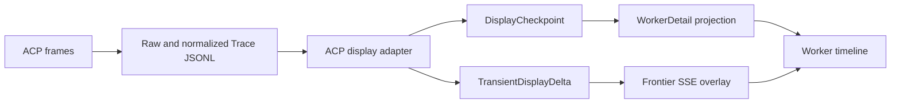

## Context

WorkerDetail is intended to be the primary long-lived Coding Agent surface. The current vertical slice has three gaps:

1. Eventing & Projection publishes `worker.follow_up` whenever the latest WorkerRun and AgentTurn are terminal, but Worker Runtime rejects that command while a nonterminal Task remains bound. A `delivered` Task therefore renders an action that cannot succeed at the same revision.
2. The durable timeline is reconstructed only from `agent_turns`, so it contains the user prompt and terminal state but omits Agent output and Tool activity already present in normalized ACP Trace JSONL.
3. ArtifactDetail verifies bytes and provides a minimal line renderer, but WorkerDetail duplicates the report as raw text and does not provide a usable changed-file review workflow.

The Task lifecycle is already correct in `task-session-persistence`: direct feedback before Task terminality remains on the same Task; chat after `completed`, `failed` or `cancelled` creates a standalone WorkerRun. This change fixes implementation and presentation rather than adding a new Task state or workflow aggregate.

TaskSpec, ContextPack and published Truth remain immutable execution inputs. This change does not reinterpret them. IntegrationEvent remains the module fan-out envelope, Trace JSONL remains execution evidence, ArtifactRef remains the canonical result pointer, and DisplayCheckpoint becomes the durable user-visible read model.

## Goals / Non-Goals

**Goals:**

- Make every projected Worker action structurally valid for the exact projected Task, Session, Run and Turn revisions.
- Keep free-form delivered feedback in the same Task and preserve terminal Task acceptance as an immutable delivery boundary.
- Make Agent messages, Tool activity, approvals, errors and Artifacts durable and replayable without exposing raw ACP frames or hidden chain-of-thought.
- Provide a resizable Report/Diff/Files Workbench with safe Markdown, integrity-aware Artifact reads and a useful multi-file patch review.
- Preserve user input across stale-target resynchronization without automatically replaying it.
- Pass a real M2 Assistant-to-Worker, delivered-feedback, accept and standalone-follow-up sequence.

**Non-Goals:**

- Replacing the Task state set or allowing `completed -> running`.
- Creating TaskSaga, TaskAttempt or another execution authority.
- Reconstructing business authority in the browser from raw IntegrationEvent or Trace data.
- Implementing per-line comments, per-hunk accept/reject, patch application or remote publication.
- Implementing Web IDE, SessionProcess or PreviewProxy runtime behavior.
- Feeding display content directly into Evolution, Truth or ContextPack compilation.

## Decisions

### 1. Route commands from the full authoritative state tuple

WorkerDetail actions are derived from:

```text
Task status and revision
WorkerSession status, binding and revision
WorkerRun status and revision
AgentTurn status and revision
actor and Workspace authorization
```

| State | Projected action | Owner behavior |
| --- | --- | --- |
| Bound Task is `delivered`; latest Run/Turn terminal | `task.continue` | Same Task returns to `running`; create a new Run/Turn in the same Session |
| Bound Task has an active Run/Turn | `worker.queue`, `worker.interrupt`, optional `worker.steer` | Target the exact active execution |
| Task is `completed`, `failed` or `cancelled`; Session is live and unbound | `worker.follow_up` | Create a standalone Run with optional `origin_task_id` |
| Session is terminal or authorization is stale | No live chat action | Read-only history or explicit continuation flow |

`ContinueTaskWithWorker` is an application command with `interaction_kind=chat|rework`. Both kinds use the existing Task follow-up domain plan and transaction boundary. The distinction is audit and presentation metadata, not a second state machine.

The command validates initiator, Task revision, Session revision and binding, previous Run/Turn terminality, execution slot and idempotency key. It atomically advances the Task, creates the new WorkerRun and AgentTurn, updates Session/Task references, appends TaskTransition and writes owner-stream Outbox. Network, model, container and ObjectStore work remain outside the transaction.

`completed` remains the stored terminal status and is rendered as `Accepted`. The WorkerSession remains independently interactive.

**Alternative considered:** Allow `completed -> running`. Rejected because it invalidates accepted-delivery reporting and makes Task duplicate WorkerSession lifecycle.

**Alternative considered:** Reuse `worker.follow_up` for every terminal Run. Rejected because a terminal Run does not imply a terminal or unbound Task.

### 2. Keep stale recovery explicit and non-replaying

Gateway returns `stale_target` plus a refreshed view reference when exact authority changed. The frontend keeps the draft, replaces the WorkerDetail replica from a current snapshot and recalculates the available send mode. It does not automatically resubmit because the message might now target a different Task or active Turn.

**Alternative considered:** Automatically retry after refresh. Rejected because idempotency protects duplicate execution, not semantic retargeting.

### 3. Materialize ACP evidence into DisplayPart

The Worker Shim continues teeing raw ACP frames into bounded raw Trace JSONL and emitting normalized Trace records. A protocol adapter converts safe normalized execution evidence into canonical DisplayMutation records:



Each AgentTurn owns one DisplayStream. Stable Switchback part ids are scoped by Runtime generation, AgentSession and provider-local source id. The adapter emits:

| Part type | User-visible content | Durable boundary |
| --- | --- | --- |
| `text` | Agent response in safe Markdown | Terminal message or Turn terminal |
| `reasoning_summary` | Provider-supplied safe summary only | Summary terminal |
| `tool` | Name, safe arguments, status, duration, locations and bounded output | Start, waiting/approval and terminal |
| `activity` | Plan and stage progress | Semantic stage transition |
| `approval` | Exact protected operation and decision | Request and decision |
| `artifact` | ArtifactRef summary and review action | Artifact finalization |
| `error` | Stable code, affected stage and safe recovery | Error classification |

Nonterminal text chunks use the best-effort transient lane and never advance durable View cursor. Every terminal Agent message and Tool lifecycle boundary produces a complete checkpoint. Reconnect discards incomplete transient overlays and converges from the latest checkpoint.

Raw provider payload, credentials, internal headers and hidden reasoning never enter DisplayPart. Large Tool output is truncated in the part and linked to authorized Trace or Artifact evidence.

**Alternative considered:** Have React parse Trace JSONL. Rejected because it moves protocol compatibility, authorization and business projection into the browser.

**Alternative considered:** Store only final report text. Rejected because it loses the interaction history needed for debugging, continuation and user trust.

### 4. Treat DisplayCheckpoint as a durable read model

PostgreSQL stores the latest versioned DisplayCheckpoint per DisplayStream and enough append-only projection metadata to page historical Run/Turn groups. The checkpoint is derived state; immutable Trace JSONL and authoritative Worker/Task records retain their existing ownership.

WorkerDetail snapshot returns a bounded latest page plus a stable timeline cursor. Earlier history loads through authorized pagination. Tool details and Artifact bytes load on demand. IntegrationEvent deduplication and owner sequence prevent duplicate display mutations; late evidence appends with provenance instead of rewriting an already published cursor.

Display content is not automatically promoted to Truth. Evolution may later consume the underlying Trace/Artifact evidence under its own policy, while ContextCompiler continues to use governed Truth and ContextPack contracts.

### 5. Replace the raw Artifact panel with a Workbench

The Worker page becomes a resizable two-pane surface:

```text
Worker timeline and composer | Report / Diff / Files / future IDE
```

WorkerDetail carries only Artifact summaries and a review manifest. Opening a Report or Patch resolves canonical ArtifactDetail bytes after tenant/user/workspace authorization and checksum verification.

Report rendering supports Markdown, tables, lists and code blocks. Raw HTML and script execution are disabled; external images do not load automatically. Provider or Runtime diagnostics render as Timeline errors/activities rather than report content.

Patch review uses `@pierre/diffs` for patch parsing and rendering and `@pierre/trees` for the changed-file tree. Switchback-owned `PatchReviewAdapter` and `ArtifactTreeAdapter` isolate their APIs and expose only canonical paths, file status, statistics, selection and render options. Candidate versions at design time are `@pierre/diffs@1.2.12` and `@pierre/trees@1.0.0-beta.5`; implementation pins verified versions and lockfile integrity.[^1][^2]

The Workbench supports all-files/file selection, unified/split layout, wrapping and hunk navigation. A zero-byte patch renders "No code changes." Binary, oversized or unparseable content keeps metadata and download access without forcing a renderer.

Task acceptance remains delivery acceptance. It does not imply a second patch apply because the WorkingCopy already contains the change.

**Alternative considered:** Keep Artifact review on a separate page only. Rejected because it breaks the chat-review-feedback loop.

**Alternative considered:** Inline every report and patch in Timeline. Rejected because large results overwhelm conversation and cannot provide an ergonomic file-oriented review.

### 6. Keep frontend library choices behind project-owned contracts

`@pierre/trees` is beta. The Workbench therefore owns narrow local adapters, local accessibility and fallback states, and characterization tests against the pinned package versions. A future replacement changes adapters rather than Frontier schemas or Artifact contracts.

## Risks / Trade-offs

- [Display projection falls behind Trace] -> Publish lag and checkpoint version in diagnostics, retain transient overlay only until a checkpoint supersedes it, and reconcile terminal Turns missing a complete checkpoint.
- [Tool output leaks secrets or becomes too large] -> Normalize server-side, apply safe-field allowlists and output bounds, and keep raw evidence behind separate authorization.
- [A projected action becomes stale after render] -> Require exact revisions at Gateway, return `stale_target`, preserve the draft and never auto-replay.
- [Beta tree API changes] -> Pin version and lockfile, isolate through `ArtifactTreeAdapter`, and maintain adapter characterization tests.
- [Large patches exhaust the browser] -> Load content on demand, render selected files, apply policy-based size limits and fall back to metadata/download.
- [Markdown introduces active content] -> Disable raw HTML, scripts and automatic remote image loads; test sanitization.
- [Accepted label hides stored status] -> Keep canonical status in diagnostics/API while rendering the product label `Accepted`.

## Migration Plan

1. Add command/action contract tests that reproduce the current delivered-bound mismatch.
2. Add `task.continue` routing while preserving existing `task.rework` compatibility.
3. Add DisplayCheckpoint persistence and reconciliation behind a projection feature flag.
4. Backfill only display state that can be reconstructed from retained normalized Trace; mark missing historical content as non-backfillable.
5. Add Workbench adapters and renderers behind a frontend feature flag while retaining current ArtifactDetail download fallback.
6. Run unit, PostgreSQL integration, Frontier replay and Playwright acceptance suites.
7. Run the M2 real-provider multi-turn acceptance sequence before enabling by default.

Rollback disables the new projection/Workbench flags and returns to the existing ArtifactDetail route. New checkpoints are derived and can be rebuilt; Task/Worker/Trace/Artifact authority is unchanged.

## Open Questions

None. Web IDE lifecycle and concurrent WorkingCopy behavior are intentionally deferred to `worker-web-ide-session-process`.

[^1]: Pierre Computer Company. "Diffs." https://diffs.com/

[^2]: Pierre Computer Company. "Trees documentation." https://trees.software/docs
