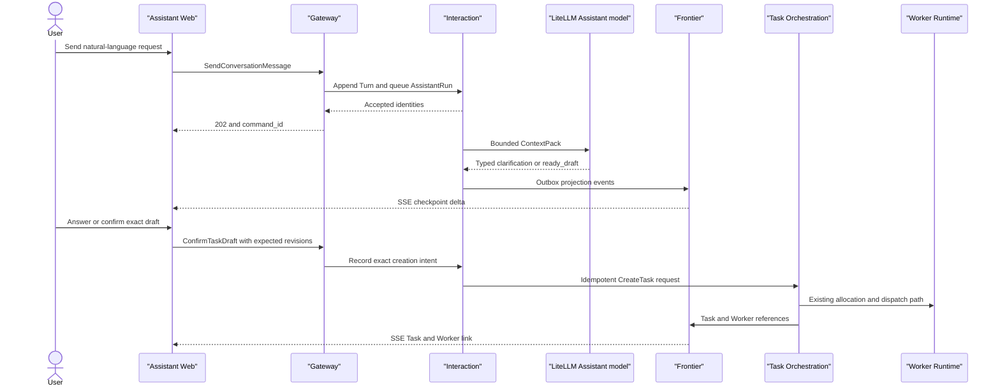

## Context

The current M1 product has durable Task, WorkerSession, WorkerRun, AgentTurn, Artifact, Trace, Frontier projection, and Docker Runtime owners. A user can create a Task from a structured form, observe real Codex execution, review report/patch artifacts, and continue the live WorkerSession.

The missing product boundary is the Assistant: users must translate intent into TaskSpec fields themselves. This change adds that translation and clarification loop while preserving the first-principles split:

- Assistant owns conversation, semantic readiness, TaskDraft, and explicit dispatch intent.
- Task Orchestration owns Task admission and business lifecycle.
- Worker Runtime owns heavy execution and never runs inside the Assistant process.
- Eventing and Frontier own asynchronous delivery and materialized views, not business truth.

M2 remains `SingleUserLocalProfile`. Server configuration injects the actor, model profile, policies, and allowed Workspace information. The browser cannot select another tenant/user or send arbitrary model, prompt-policy, Tool, runtime, or secret configuration.

## Goals / Non-Goals

**Goals:**

- Accept a natural-language message quickly and process it asynchronously.
- Persist a restart-safe Conversation and ordered Turns.
- Produce a typed, versioned readiness assessment across the seven frozen dimensions.
- Ask one highest-priority blocking question at a time and checkpoint every three consecutive questions.
- Produce a revisioned human-readable TaskDraft and require explicit confirmation of the exact ready revision.
- Dispatch through the existing Task Orchestration and M1 Worker path with idempotent, stale-safe commands.
- Render Conversation, clarification, draft, confirmation, and resulting Task/Worker links through Frontier snapshot and SSE.
- Archive phase-complete Assistant evidence as scoped JSONL without hidden chain-of-thought.

**Non-Goals:**

- Delivery/Feishu, shared-channel participants/controllers, cross-Workspace Conversation rollover, and channel disclosure.
- Evolution, OpenViking retrieval, Inspiration, generated Skills, or Skill Market installation.
- Multi-user login, SSO/OIDC, dynamic Membership/RBAC, or remote Web exposure.
- Assistant Tool execution, repository mutation, shell commands, Worker control, artifact generation, or direct Docker access.
- Worker result summarization inside the Assistant Conversation; M1 Task and Worker views remain the result surface for this slice.
- Runtime recovery, managed B2 GitHub writes, alternate coding agents, or provider fallback inside one AssistantRun.

## Decisions

### Interaction is a separate durable owner

Add `internal/interaction` with domain, application, PostgreSQL adapter, model adapter, ObjectStore evidence adapter, and projection adapter. Its durable entities are:

| Entity | Responsibility |
|---|---|
| `Conversation` | Stable single-user interaction identity, optional exact Workspace resolution, status, revision, and ordered Turn sequence |
| `ConversationTurn` | Immutable user or user-visible Assistant content with actor, sequence, causation, and timestamps |
| `AssistantRun` | One asynchronous processing attempt for an accepted user message, including model profile and terminal outcome |
| `ContextPack` | Bounded prompt inputs, selected/dropped references, policy revisions, and token estimates |
| `TaskDraft` | Revisioned structured goal, deliverables, acceptance, constraints, Workspace, assumptions, and TaskSpec digest |
| `TaskReadinessAssessment` | Immutable seven-dimension semantic readiness snapshot |
| `ClarificationCheckpoint` | Every-three-question decision point and its user choice |
| `ExplicitTaskCreationIntent` | Immutable actor/draft/readiness/Workspace/policy/digest/idempotency evidence used by Task admission |

Alternative considered: store Assistant state in Task Orchestration. Rejected because clarification can exist without a Task, and making draft conversation state part of Task would recreate the heavy pre-execution workflow removed from P0.

### Gateway acceptance is transactional and model-free

`SendConversationMessage` performs one short PostgreSQL transaction:

1. Revalidate server-owned actor, Conversation revision, Workspace access, and idempotency.
2. Append the user Turn and allocate its owner sequence.
3. Create a queued AssistantRun.
4. Write the owner-stream Outbox event.
5. Return `202` with `command_id`, `turn_id`, `assistant_run_id`, and a projection reference.

The transaction performs no model, ObjectStore, network-provider, or Task call. An outbox-driven dispatcher claims queued runs. One Conversation has at most one active AssistantRun; later user messages remain in stable sequence order.

Alternative considered: hold the HTTP request until the model finishes. Rejected because it couples browser/provider timeouts to business acceptance and conflicts with the platform's asynchronous event model.

### The model returns a typed proposal, never authority

The Assistant model adapter returns a versioned `AssistantDecision` with one of:

- `clarification`: one user-visible question plus proposed dimension updates.
- `ready_draft`: proposed TaskDraft fields, assumptions, and readiness evidence.
- `informational`: a non-dispatch answer for brainstorming or an explicit cancellation.

The application layer validates JSON shape, known enum values, field limits, Workspace identity, allowed assumptions, policy revision, and TaskSpec schema before committing any result. Model output cannot create an intent, Task, Tool call, Worker command, permission, or Workspace selection.

Invalid or policy-conflicting output terminates the AssistantRun with a sanitized retryable diagnostic. M2 does not automatically switch providers or silently convert hard blockers to assumptions.

Alternative considered: let the model call Task creation as a Tool. Rejected because generated Tool intent is not authenticated user intent and would make prompt behavior part of the authorization boundary.

### M2 ContextPack is deliberately narrow

The ContextCompiler includes only:

- the active Conversation generation and a bounded recent-Turn window
- latest TaskDraft/readiness/checkpoint state
- versioned Assistant rules and TaskReadinessPolicy
- server-authorized Workspace/repository/revision metadata
- TaskSpec schema and enabled server-owned Assistant model profile

Each ContextPack records selected items, estimated tokens, priorities, and dropped reasons. Workspace-scoped inputs are excluded until the user explicitly selects an authorized Workspace. Evolution Truth, Inspiration, Worker Trace, Artifact bodies, arbitrary Skill content, and predecessor Conversations are absent from M2.

Alternative considered: load all M1 Trace and repository content for better answers. Rejected because it expands permission, token, and prompt-injection scope before retrieval governance exists.

### Readiness and confirmation are separate gates

`TaskReadinessPolicy` evaluates:

1. goal
2. deliverable and acceptance
3. scope and target
4. constraints
5. context and access
6. risk and approval
7. execution policy

Each dimension is `known`, `assumed`, `blocking_unknown`, or `not_applicable`. Low-risk reversible defaults require a policy rule id and become visible TaskSpec assumptions. Access, conflicting goals, production/external/irreversible effects, and untestable outcomes remain hard blockers.

The Assistant asks only the current highest-priority blocker. After three consecutive clarification questions it creates a ClarificationCheckpoint with continue, narrow-scope, and cancel. A confirm action is exposed only for a ready TaskDraft with no hard blocker.

Confirmation targets exact Conversation, TaskDraft revision, readiness id, Workspace resolution/revision, TaskSpec digest, actor, and policy revision. Any change makes the old action stale. Free-text agreement does not implicitly confirm a draft.

Alternative considered: create a Task automatically when readiness becomes ready. Rejected because semantic readiness proves executability, not user authorization to spend resources or perform work.

### Task Orchestration remains the only Task creator

Confirmation creates an immutable `ExplicitTaskCreationIntent` and an outbox request. Task Orchestration consumes the request and, in its existing Task transaction:

- revalidates actor, exact Workspace, readiness status, intent binding, TaskSpec digest, current policy, and idempotency
- enforces unique use of the intent
- creates Task, initial TaskTransition, SessionAllocationRequest, and owner-stream Outbox

Duplicate confirmation or response loss returns the original intent/Task identity. Interaction never allocates WorkerSession, starts WorkerRun, or advances Task status.

### Frontier owns the browser read model

Add an `assistant_conversation` ProjectionSnapshot and typed deltas using the existing epoch/cursor/version contract. The projection contains user-visible Turns, active-run state, blocker, assumptions, checkpoint choices, current TaskDraft, allowed commands, pending command outcomes, and resulting Task/Worker references.

Transient model token chunks are not required in M2. User-visible Assistant content becomes durable only as committed ConversationTurn/checkpoint state. The browser does not join raw Outbox events, model payloads, JSONL, or Task database rows.

The Web adds a focused Assistant route and reuses existing query, projection-store, SSE, resync, pending-command, and Task/Worker deep-link patterns.

### Evidence and observability have different authority

PostgreSQL is authoritative for Conversation, run, readiness, draft, intent, and projection cursors. On clarification checkpoint, ready draft, Task creation, cancellation, or run failure, an asynchronous evidence projector writes checksum-addressed JSONL segments to the existing LocalFile ObjectStore and records a manifest/reference.

JSONL includes visible Turns, structured decisions, policy/model profile revisions, correlation ids, Workspace scope snapshot, and Task/Worker references. It excludes hidden chain-of-thought and provider credentials. Langfuse may receive Assistant trace/span/generation observations as a derived local projection, but its availability cannot change Interaction or Task outcome.

### Failure handling is explicit and retry-safe

- Gateway/response loss: same idempotency key returns original accepted identities.
- Backend restart: queued/running ownership is reconstructed from PostgreSQL; a run with unknown model effect is not blindly duplicated.
- Model timeout or invalid response: AssistantRun becomes failed with a safe retry action; no Task is created.
- Stale reply or confirmation: command returns stale target plus refreshed projection reference.
- Task creation consumer retry: intent and TaskSpec digest return the original Task.
- ObjectStore/Langfuse failure: evidence/observability degradation is visible and retried without changing the committed Conversation or Task outcome.

## Risks / Trade-offs

- [Risk] Model semantic judgment is nondeterministic -> Mitigation: persist exact policy/input references and typed output, apply deterministic hard gates, and test the adapter with scripted model responses.
- [Risk] A single active AssistantRun increases latency when users send messages quickly -> Mitigation: preserve stable queue order and expose queued state; do not add concurrent draft mutation in the first slice.
- [Risk] Explicit confirmation adds one interaction even for clear requests -> Mitigation: keep the preview compact and preserve the direct TaskSpec API as a zero-question explicit path.
- [Risk] M2 context may be too weak without Truth or repository retrieval -> Mitigation: measure clarification and dispatch outcomes first; add governed providers later through ContextCompiler ports.
- [Risk] JSONL and Langfuse retain sensitive user/model content -> Mitigation: keep loopback-only scope, exclude credentials and hidden reasoning, preserve checksum/source metadata, and require a new policy before multi-user exposure.
- [Risk] Interaction and Task projections can temporarily disagree -> Mitigation: expose command pending state, causal references, idempotent projectors, and resync instead of browser-side authority reconstruction.

## Migration Plan

1. Add additive Interaction tables, indexes, idempotency constraints, and projection schema.
2. Add ports and deterministic fake model tests before the LiteLLM adapter.
3. Add asynchronous Gateway/dispatcher flow and JSONL evidence with the direct Task path unchanged.
4. Add exact confirmation-to-Task admission and end-to-end tests against the existing M1 Worker path.
5. Add Frontier projection and Assistant Web route behind a local configuration flag.
6. Enable the Assistant route by default after scripted and one real-provider acceptance pass.

Rollback disables the Assistant route/dispatcher and leaves the existing direct TaskSpec form/API operational. Additive Interaction rows and JSONL evidence remain readable; no Task or Worker schema downgrade is required.

## Open Questions

There are no blocking product questions for this slice. Context token limits, model timeout values, Turn-window size, and archive batching thresholds remain server-owned operational settings and must be measured without changing the contracts above.
