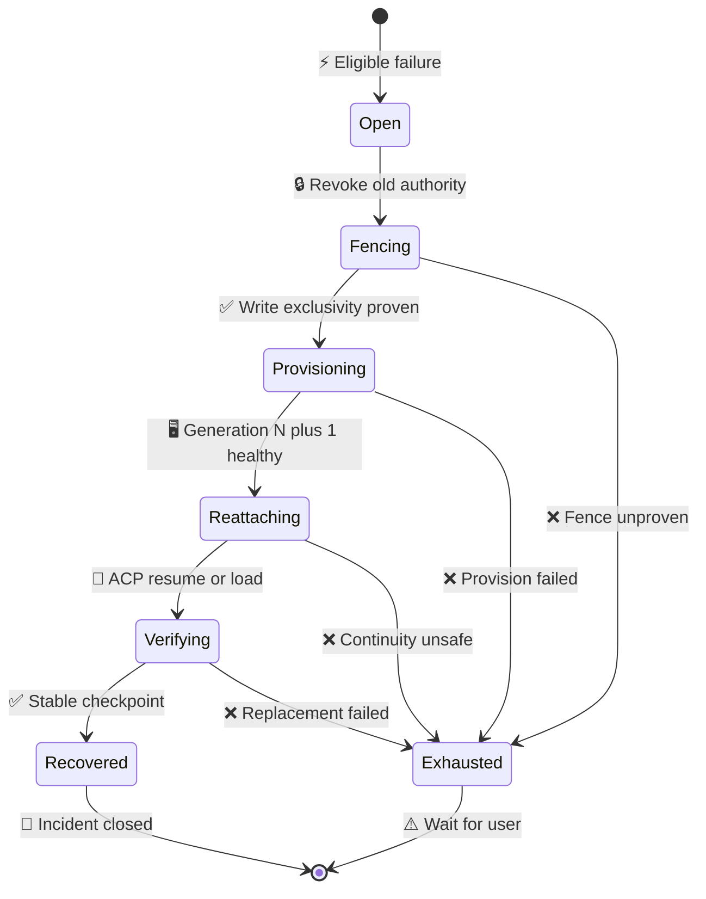
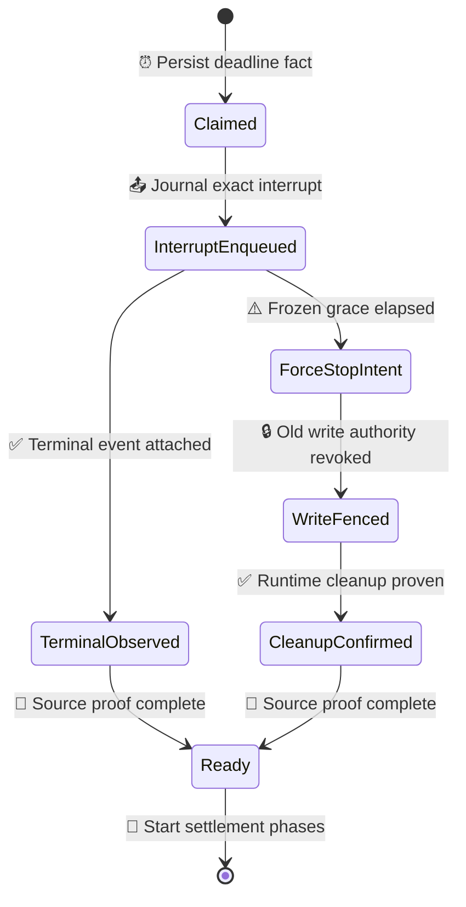
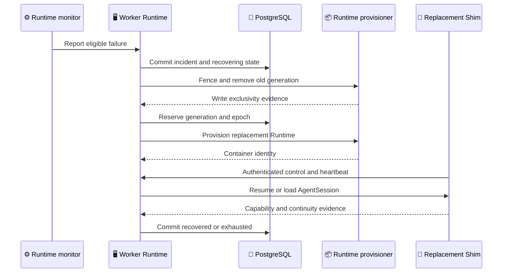

## Context

M1 already persists WorkerSession, WorkerRun, AgentTurn, RuntimeInstance, WorkingCopy, Agent state, generation/ChannelEpoch control identities, deadlines, Trace and Artifact evidence. The Shim emits RuntimeHeartbeat. Runtime loss handling, however, was originally limited to generation 1 and the first recovery slice still keeps WorkerControl credentials, cursors, replay buffers and stream ownership only in Backend memory.

The accepted platform contract requires one automatic replacement attempt for each continuous eligible RuntimeRecoveryIncident. Recovery must preserve execution identity and durable state without replaying an unproven prompt or external side effect. It must also survive Backend restart, keep the original AgentTurn deadline, and never allow two generations to write the same WorkingCopy.

## Goals / Non-Goals

**Goals:**

- Detect eligible Runtime failure from hard evidence or heartbeat progression.
- Persist one durable incident and at most one replacement attempt.
- Fence the failed generation before generation `N+1` receives control, secrets or WorkingCopy write authority.
- Preserve WorkerSession, WorkerRun, AgentSession, WorkingCopy, durable Agent state, control cursors and evidence lineage.
- Resume or load the pinned ACP session only when negotiated capabilities and fixed-image evidence make it safe.
- Restore a healthy live Runtime's exact control stream after Backend restart without changing generation, ChannelEpoch, Runtime, Run or Turn identity.
- Converge retries, duplicate triggers and Backend restart on the same incident and replacement identity.
- Surface exhausted or ineligible recovery as actionable `waiting_user` without a crash loop.

**Non-Goals:**

- Replaying an active AgentTurn prompt when its effect state is unknown.
- Recovering user cancellation, Session idle/absolute expiry, authorization, policy, schema or protocol failure.
- Retrying non-idempotent or unknown external side effects.
- Extending or resetting AgentTurn deadline.
- Hibernation, planned Runtime migration, multi-host failover or more than one automatic attempt per incident.
- Multi-Backend active-active ownership and reconnecting a restarted Shim process under the same Runtime generation.
- HTTPS long-poll WorkerControl fallback.

## Decisions

### 1. Worker Runtime owns a durable recovery incident

`RuntimeRecoveryIncident` is the sole owner of detection evidence, failed generation, attempt count, replacement identity and terminal outcome. Its states are persisted with revision and idempotency fencing.



The incident uses one monotonic `attempt_count`. A failure after `Recovered` creates a new incident only when the prior incident had closed after the required stability evidence. A failure during fencing, provisioning, reattachment or stability verification exhausts the same incident.

Alternative considered: let Docker restart policy replace the container. Rejected because Docker cannot atomically fence Switchback control, secrets, mount authority, AgentSession continuity or Task/Run state.

### 2. Separate failure detection from quiet Agent work

Eligible triggers are:

- Confirmed container or Shim process exit
- Docker reports the active container missing
- Authenticated stdio/ACP EOF proves process loss
- RuntimeHeartbeat reaches `suspect` after 45 seconds and `unhealthy` after 90 seconds using server receive time and monotonic sequence

WorkerControl transport closure by itself is not process-loss evidence. It enters a bounded reconnect state while Backend inspects the exact container and waits for the authenticated live Shim to resume. `active_quiet`, absence of model tokens, provider latency and Tool silence do not trigger recovery. A hard container/process signal may open an incident immediately without waiting 90 seconds.

`ResumeComplete` proves transport ownership and cursor convergence, not process
liveness. When the exact Runtime generation and ChannelEpoch has no persisted
heartbeat observation, the PostgreSQL transaction that commits its first
`ResumeComplete` also arms one durable first-heartbeat watchdog. Its immutable
anchor is that first `resume_completed_at` plus the exact resume-completed
revision, and the transaction creates the T+45 suspect ScheduledCommand.
Failure to persist either the barrier, watchdog or command rolls back the whole
operation. If a real heartbeat observation already exists, no first-heartbeat
watchdog is armed.

A duplicate `ResumeComplete` or healthy transport reconnect reuses the same
watchdog, anchor and T+45/T+90 deadlines; reconnect never grants another 90
seconds. The first strictly sequenced, authenticated RuntimeHeartbeat received
before T+90 persists its observation and moves an `awaiting` or `suspect`
watchdog to `satisfied` in the same transaction, recording its heartbeat
sequence, control sequence and server receive time while cancelling pending
watchdog commands. `ResumeComplete`, sequence zero and container `sent_at`
cannot substitute for that liveness proof.

At T+45 the durable evaluator marks an ordinary `starting|active` Runtime
`suspect` and schedules the exact T+90 evaluation. At T+90 an ordinary live
Runtime becomes `unhealthy` with a persisted, replay-stable
`heartbeat_unhealthy` recovery intent. If the Runtime is already the
replacement for an open incident, the watchdog records
`replacement_first_heartbeat_timeout`; it does not open a nested incident or
attempt generation `N+2`. A heartbeat received at or after the immutable
unhealthy boundary cannot revive that generation.

Backend startup drains due AgentTurn deadline and first-heartbeat watchdog
commands before it marks startup ready. When reconstructing a live Runtime
candidate it uses, in order, the latest server-received heartbeat, the durable
first-authenticated-resume anchor, Runtime `started_at`, then Runtime
`created_at`. Backend restart therefore continues the remaining original
window instead of resetting it.

A live Runtime already owned by a Backend-deadline settlement whose frozen
`force_after` is still in the future is different from an ordinary liveness
candidate. Startup restores its server-owned environment, inspects the exact
running container and verifies credential identity, then immediately marks the
candidate deferred. It does not wait for that grace deadline inside the global
startup restore group. The durable deadline-source worker continues the frozen
branch, and post-ready unowned-Runtime adoption may attach the Runtime after
settlement authority clears.

The T+45/T+90 evaluator also closes the crash/backlog window where a
RuntimeHeartbeat is already durable in the control journal but the ordinary
ordered event pump has not projected its business observation. While holding
the same Session, Runtime and watchdog locks, it searches accepted event rows
in sequence order and only considers candidates whose durable `created_at` is
strictly before the immutable `unhealthy_due_at`. The exact Envelope and
RuntimeHeartbeat payload must decode strictly and match the watchdog's
Session, Runtime, generation and ChannelEpoch. Invalid payloads and a heartbeat
accepted exactly at T+90 or later cannot satisfy the watchdog.

For all valid candidates in control-sequence order, the evaluator calls the
same transactional heartbeat recording path. The first valid heartbeat
creates the observation and freezes the first-heartbeat proof; later valid
heartbeats advance the ordinary liveness observation to the latest monotonic
heartbeat sequence and server receive time. Each step restores liveness when
applicable and replaces the prior pending ordinary liveness check, leaving one
check anchored to the freshest accepted heartbeat.
It deliberately leaves the journal message in its current receipt/application
state and does not advance `event_applied_sequence`, so it cannot bypass an
earlier business event. The ordered pump later replays and applies the
heartbeat normally; duplicate-safe observer/store semantics preserve the
existing observation revision, first-heartbeat proof and single liveness
command. Database integration tests cover this repair and replay behavior;
production/fixed-image acceptance remains a separate enablement gate.

Heartbeat recording plus first-heartbeat and ordinary liveness evaluation use
the same AgentTurn outcome critical section as terminal, deadline and recovery
writers. They resolve the exact active Turn and acquire its advisory lock
before locking the mutable Session/Runtime graph, then revalidate Run/Turn
identity after the graph lock. An active Run/Turn switch in that gap triggers
one bounded cross-transaction retry so heartbeat delivery does not close its
control stream and a startup first-heartbeat drain does not fail readiness on
a transient identity snapshot. This also serializes behind an earlier terminal
claim whose settlement row is not committed yet. A pending Runtime-event
settlement cancels the watchdog as `turn_outcome_owned`; a pending
Backend-deadline settlement cancels it as `backend_deadline_owned`. Neither
path may mark the Runtime unhealthy or open a competing recovery incident. A
valid heartbeat that races after settlement ownership is established still
records its observation and may satisfy the first-heartbeat proof only when it
is strictly before T+90. At or after T+90 it remains audit evidence instead of
rolling back the transaction or closing the control stream. In all
outcome-owned cases it does not restore `suspect -> active`, increment the
Runtime revision, or cancel/recreate ordinary liveness commands.

Alternative considered: ping ACP with a no-op prompt. Rejected because the fixed ACP/Codex stack has no safe non-mutating liveness method.

### 3. Treat healthy WorkerControl reconnect as transport continuity, not Runtime recovery

WorkerControl uses a durable `ControlJournal` whose authority is PostgreSQL. `RuntimeControlChannel` stores the exact WorkerSession, RuntimeInstance, generation, ChannelEpoch, credential digest, process nonce, stream attempt, owner fence, bidirectional committed/acknowledged/applied cursors and journal revision. `RuntimeControlMessage` stores each sequenced command or event, its message and idempotency identities, exact envelope, payload digest, effect status and timestamps.

The bearer credential remains plaintext only in the server-owned Runtime bootstrap secret and live Shim memory; PostgreSQL stores its SHA-256 digest. Backend startup rehydrates eligible live identities from PostgreSQL and their exact server-owned bootstrap paths before accepting dispatch. A new stream claims a monotonically fenced owner attempt; an older owner or stream attempt cannot append, ACK or apply messages.

The wire protocol is an explicit tagged frame:

```text
WorkerControlFrame =
  ResumeHello
  | ResumeAck
  | RuntimeControlEnvelope
  | ResumeReady
  | ResumeComplete
```

The first Shim frame is `ResumeHello`. It carries exact Runtime identity, a stable per-process nonce, monotonically increasing stream attempt, both durable cursor views and the active Turn/effect state when present. Transport authentication is completed from gRPC metadata before the Hello is admitted; authentication failure is a gRPC `Unauthenticated` status and is not an application-level `ResumeAck` rejection. Backend atomically validates the persisted credential digest, current Runtime authority, cursor digests and active Turn identity, then replies with `ResumeAck` containing authoritative cursors and a replay plan.

The peers then exchange only replay envelopes. Shim sends every locally spooled event from `ReplayWorkerFromSequence` through the exact `WorkerTXLastSequence` declared in Hello, and durably receives Backend commands through the `BackendTXLastCommandSequence` declared in Ack. It then sends `ResumeReady` with `worker_tx_replayed_through_sequence` and `worker_rx_received_through_sequence`. Per-direction stream ordering makes every Worker replay envelope precede Ready on the Backend receive side; Backend persists those envelopes before processing Ready and therefore does not need an otherwise circular intermediate ACK-progress frame. `ResumeComplete` is committed by the journal, not inferred in Hub memory: it verifies the connection-bound claim revision, final event/command sequences and digests, applied bounds and active-Turn proof in one transaction. When no exact heartbeat observation exists, that same transaction arms the immutable first-heartbeat watchdog described above. Its committed Worker cursor is the final cumulative receipt ACK. Ordinary messages remain frozen until that barrier commits.

Cursor digest v1 is a direction-separated SHA-256 hash chain. The zero-message value is the `sha256:`-prefixed hex SHA-256 of `switchback.runtime-control.cursor.genesis.v1`. Each advance hashes length-prefixed `switchback.runtime-control.cursor.v1`, direction, previous digest bytes, big-endian sequence and the envelope digest. Envelope digest uses a fixed field order, unsigned big-endian numbers, UTC RFC3339Nano time and canonical JSON payload with lexical object-key order, preserved JSON numbers and no insignificant whitespace. The contract package publishes fixed vectors; Backend and Shim must call the same implementation rather than constructing private variants.

Commands are journaled and assigned a sequence before transport send. The caller submits only a logical command; while holding the PostgreSQL channel lock, the journal assigns the next sequence, snapshots the current event receipt ACK and server time, constructs the exact envelope, then persists it. Hub never predicts a sequence, ACK or `sent_at`.

Events are journaled as `received` before Backend advances the durable-receipt ACK; their application effect and outcome advance a separate applied cursor. Pending committed-but-unapplied inbox messages survive Backend restart and are redelivered internally in order. The business handler remains idempotent by exact message identity, so a crash after its effect but before the applied marker converges without asking Shim to resend an already committed event.

An interrupted event replay keeps both the oldest unresolved digest checkpoint and the current Hello final target. A later Hello may extend the final target but cannot overwrite the older checkpoint; Backend verifies each checkpoint as replay reaches it and verifies the final target again at `ResumeReady`. Exact duplicate sequence and digest are idempotent; gaps, stale owner fences, or conflicting fingerprints fail closed. A Backend restart replays only unacknowledged journal entries and does not emit `runtime.ready`, reopen ACP or create a recovery incident.

`AckSequence` proves durable receipt only. `agent_turn.start` also has an explicit effect state:

```text
received -> prompt_invocation_intent -> active -> terminal
```

The live Shim deduplicates the exact start-command identity and never invokes ACP `Prompt` twice. Active-Turn `start_envelope_digest` is exactly `RuntimeControlEnvelopeDigest` of the journaled `agent_turn.start` command, including sequence, ACK, identities, canonical payload and sent time; `terminal_envelope_digest` uses the same algorithm over the exact terminal event envelope. Neither field is a prompt-only or arbitrary payload digest. Backend advances AgentTurn from `delivered` to `consumed` only after persisting the authenticated `active` effect acknowledgement. If the same live Shim reports that exact active Turn during resume, Backend can reconcile a response-loss window without resending the prompt. A terminal effect remains the latest proof until a higher start-command sequence begins the next Turn; terminal therefore closes one effect identity instead of permanently monopolizing the resident Runtime. If the Shim process itself failed between prompt intent and provable ACP activation, exactly-once cannot be proven and the existing `recovery_continuity_unproven` path remains authoritative.

Terminal receipt is not the end of business settlement. Backend must still
freeze and publish exact Turn evidence, commit the terminal Session/Run/Turn
transition, settle the bound Task, apply the terminal inbox event and only then
start an accepted queued continuation. These steps cannot rely on an in-memory
event delivery lease: after the inbox event is applied it will not be
redelivered, while evidence ids/timestamps and WorkingCopy content are not
safe to regenerate from mutable state.

`WorkerTurnSettlement` is therefore the durable owner of this convergence. A
terminal-source acceptance transaction creates its exact identity header before
the source can trigger external effects. It then advances monotonically through
frozen evidence, domain-committed post-revisions, evidence publication, one
frozen Task action, source application, optional queued continuation and
completion. Each external/DB boundary records an exact digest and idempotency
result; a short fenced lease allows Backend restart to resume without two
settlement workers. For a Runtime-event source, terminal event effect, inbox
applied cursor and settlement source-applied phase advance in one PostgreSQL
transaction. A stale terminal event explicitly records an ignored settlement
path rather than blocking the ordered inbox. Ordinary top-level dispatch cannot
overtake an unfinished settlement, and the queued continuation reconciler is
admitted only after the terminal source is applied.

#### Terminal source union

`WorkerTurnSettlement` owns exactly one immutable terminal fact for an
AgentTurn:

- `runtime_event` when Backend durably accepts an authenticated terminal event
  before the fixed `deadline_at`
- `backend_deadline` when server time reaches `deadline_at` before a prior
  Runtime terminal fact wins

`RuntimeRecoveryIncident` is not a terminal source. It is a nonterminal
execution claim that may preserve the current AgentTurn, and it remains
preemptible by the fixed AgentTurn deadline, WorkerSession absolute expiry or a
future authenticated security-termination authority.

The settlement header records `source_kind`, canonical reason,
`source_occurred_at`, source reference and digest, plus an append-only
`source_state` proof. Runtime-event identity remains exact and foreign-keyed to
the inbox journal. Those event columns are nullable for a Backend deadline and
may later attach an exact terminal event only as cancellation evidence; the
late event cannot change the selected source.



The claim freezes `force_after = deadline_at + 30 seconds`; Backend restart
never grants a fresh grace period. `ClaimBackendDeadline`, terminal event
acceptance and `RuntimeRecoveryIncident` opening use the same per-AgentTurn
advisory transaction lock. If deadline wins while recovery is active, the claim
transaction closes the incident as preempted and binds the settlement, but does
not directly mutate AgentTurn, WorkerRun, WorkerSession or Task terminal state.
The settlement remains the sole business-terminal writer.

For a forced deadline, Runtime termination, active-Runtime release,
Session/Run/Turn terminal transitions and the settlement `domain_committed`
phase advance in one PostgreSQL transaction after cleanup evidence proves that
the old generation has lost write authority. This replaces the unsafe pattern
of committing business terminality and recording forced Runtime cleanup in a
later transaction.

If the Backend-deadline source instead reaches `terminal_observed`, the exact
authenticated Runtime witness avoids force-stop cleanup. Domain commit accepts
an exact `active` or `suspect` Runtime predecessor, advances only
Session/Run/Turn to the deadline-owned result, and preserves Runtime status,
revision and resident binding. A suspect liveness transition therefore cannot
permanently block a graceful terminal settlement, while the settlement still
cannot forge health restoration or Runtime cleanup proof.

Source application is polymorphic but has one phase contract:

- A Runtime-event source atomically applies the exact inbox message and advances
  the settlement source-applied proof.
- A Backend-deadline source without an event advances source-applied directly
  under the settlement lease and fence.

Startup replays pending Backend-deadline `source_state` without requiring an
in-memory terminal delivery or live Runtime stream. Ordinary recovery and
top-level dispatch stay blocked until the source-union settlement reaches
completion.

Alternative considered: forge a synthetic Runtime terminal event for a Backend
deadline. Rejected because it would attribute a server lifecycle decision to
the Runtime, violate the Runtime-control journal authority and hide the
force-stop crash windows that require explicit proof.

The JSON Schema is the structural wire contract. The Go `DecodeRuntimeControlFrame`/`Validate` path is authoritative for unsigned cursor arithmetic, digest-chain equality and cross-field comparisons that JSON Schema cannot express; the RPC codec must invoke that decoder rather than plain `json.Unmarshal`.

Alternative considered: reset in-memory sequence maps on a new gRPC stream. Rejected because it permits sequence reuse, loses response-loss messages and cannot distinguish a received command from an invoked prompt.

Alternative considered: persist only high-water cursors. Rejected because a cursor cannot reconstruct the exact unacknowledged envelope or prove that a replay has identical content.

### 4. Commit intent before external side effects

No Docker, filesystem, ACP, model or network operation runs inside the PostgreSQL transaction that changes incident or aggregate state.



Every phase is restart-reconcilable from PostgreSQL. Repeating the same phase idempotency key returns the existing outcome; conflicting content fails closed.

### 5. Fence write and control authority before replacement

Opening the incident revokes new dispatch permits and marks WorkerSession `recovering` without changing Task identity. Before provisioning generation `N+1`, RuntimeSupervisor must prove the old container stopped or lost WorkingCopy write access, revoke its ChannelEpoch and generation-scoped control credential, and acquire exclusive mount authority for the replacement.

Generation `N+1` receives a new RuntimeInstance id, ChannelEpoch, WorkerControl credential and generation-scoped SecretLease. It remounts the existing server-owned WorkingCopy, Agent state and Trace spool. Failure to prove write exclusivity exhausts recovery and keeps the Session from accepting more work.

Alternative considered: start the replacement before old-container cleanup finishes. Rejected because concurrent mounts create split-brain WorkingCopy and Trace writes.

### 6. Preserve identity without replaying uncertain work

Recovery preserves WorkerSession, WorkerRun and AgentSession identity. It also preserves the current AgentTurn identity and original `started_at`/`deadline_at` while continuity is being established.

The replacement initializes ACP and verifies required capabilities. It prefers `session/resume`; if resume is unavailable or fails before any new prompt, it may use capability-declared `session/load` within the same attempt. Load replay is tagged with the replacement generation and deduplicated against durable DisplayCheckpoint and Trace source identities.

The system never resends the original prompt automatically. If the adapter can prove the original underlying turn and effect state, it reconciles the existing AgentTurn. If exact active-turn continuity is not provable, the replacement may remain resident but the AgentTurn terminates with `recovery_continuity_unproven`; WorkerRun and WorkerSession enter `waiting_user` so the user can start a new Turn under the same Run.

Alternative considered: create a fresh AgentSession and replay Conversation/ContextPack. Rejected because it silently changes execution identity and can duplicate Tool or external effects.

### 7. Close only after health and durable progress evidence

Container start alone is insufficient. Before closing an incident, the replacement must prove:

- Authenticated WorkerControl with the reserved generation and ChannelEpoch
- Independent valid RuntimeHeartbeat
- LiteLLM and ACP initialization health
- Required resume/load capability and exact AgentSession attachment
- WorkingCopy mount identity and exclusive write authority
- Control command/event/Trace cursor convergence
- Either a durable post-attachment progress checkpoint or completion of a server-owned stability window

The stability-window value is deployment configuration measured by fixed-image acceptance, not TaskSpec input. The AgentTurn deadline continues during every recovery phase.

### 8. Keep Task lightweight and project recovery state from Worker ownership

During an eligible attempt, Task remains `running` and points to the same WorkerSession and WorkerRun. WorkerDetail projects `recovering_runtime`, failed generation, replacement generation when known, attempt count, evidence time and allowed actions from Worker-owned events.

If recovery exhausts:

- A nonterminal bound Task enters `waiting_user:runtime_recovery_failed`.
- WorkerRun and WorkerSession enter `waiting_user`.
- A delivered or terminal Task remains unchanged.
- The user may retry work only through an existing explicit interaction command; the failed incident itself cannot be retried automatically.

TaskTransition and owner-stream IntegrationEvent commits remain transactionally ordered. EventCenter and Frontier project recovery but do not own its state machine.

### 9. Preserve evidence across generations

Trace JSONL segments retain Runtime generation and ChannelEpoch provenance under the same Session/Run/Turn lineage. Proven pre-failure TraceManifest and ArtifactRef records remain authoritative. Late old-generation events are captured as non-authoritative Trace evidence and cannot mutate current aggregates, DisplayCheckpoint or Artifact finalization.

Recovery metadata is available to operations and future Evolution consumption, but Truth and ContextPack must distinguish platform recovery evidence from user/domain facts.

## Risks / Trade-offs

- [ACP resume/load is unreliable in the pinned image] → Make fixed-image restart conformance a release gate; unsafe attachment exhausts recovery without a fresh AgentSession.
- [The failed generation still writes the WorkingCopy] → Require confirmed stop or exclusive mount fencing before provisioning; otherwise enter `waiting_user`.
- [A prompt or Tool side effect is duplicated] → Never replay the prompt automatically and block continuation when active-turn effect state is uncertain.
- [Duplicate liveness signals create multiple replacements] → Persist one incident keyed by Session and failed generation, and reserve one replacement identity transactionally.
- [Backend restarts mid-recovery] → Persist every phase and reconcile external resources by exact server-owned identity.
- [Backend restarts while a healthy prompt is active] → Keep Shim execution independent from stream lifetime, persist both message directions and reconcile explicit prompt effect state before replay.
- [A stale Backend or stream keeps writing] → Require monotonically fenced control ownership on every journal mutation and reject stale owner/attempt identities.
- [Reconnect buffering grows without bound] → Use a bounded server-owned/local resend spool with backpressure; overflow makes continuity unproven rather than silently dropping evidence.
- [Recovery consumes the remaining Turn deadline] → Preserve the fixed wall-clock deadline and allow deadline handling to preempt recovery.
- [Late events corrupt current state] → Reject old generation/epoch at the control seam and retain bytes only as non-authoritative Trace.
- [A replacement fails after appearing healthy] → Keep the incident open until stable progress evidence; a failure inside that window consumes the sole attempt.

## Migration Plan

1. Add incident, mount-fence, heartbeat observation and replacement-intent persistence without enabling automatic replacement.
2. Generalize generation-1 validators, Runtime secrets, WorkerControl and Docker identity to generation `N`.
3. Add the liveness monitor and incident creation behind a disabled server feature flag.
4. Add durable WorkerControl authority, bidirectional journal, explicit resume frames and active-Turn effect acknowledgement while keeping recovery disabled.
5. Rehydrate healthy live Runtime control identities at Backend startup and change transport close from an immediate failure trigger to bounded reconnect/liveness evaluation.
6. Implement old-generation fencing, exact cleanup and generation `N+1` provisioning with deterministic fake adapters.
7. Implement ACP resume/load reattachment, replay deduplication and active-turn continuity classification.
8. Project recovering/exhausted state and update Task waiting-user convergence.
9. Persist terminal Turn settlement and reconcile evidence, Task action, inbox application and queued continuation before ordinary dispatch can resume.
10. Run fixed-image fault acceptance for idle loss, active loss, Backend restart, duplicate triggers, failed fencing, failed replacement, stale events and deadline expiry.
11. Enable one-attempt recovery for SingleUserLocalProfile after the conformance gate passes.
12. Roll back by disabling new incident attempts; already-open incidents still reconcile to recovered or exhausted, and no stored state is deleted.

## Open Questions

The fixed-image acceptance must measure the stability-window duration and cancellation grace before production defaults are selected. These are deployment constants, not user-configurable TaskSpec fields.
