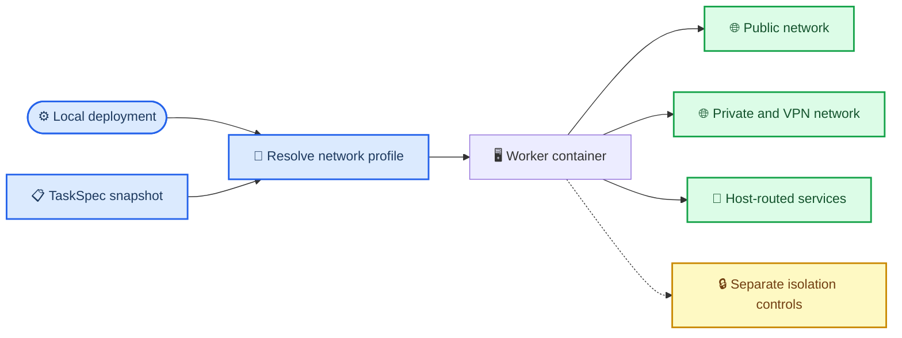

## Context

M1 currently admits `m1_public_web_restricted_v1`, while the Docker adapter attaches each Worker to a server-selected named bridge without implementing the private-network filtering implied by that name. The approved product direction is different: SingleUserLocalProfile is a trusted development environment whose Worker must reach every public, private, VPN, LAN and host-routed service available through the developer machine.

The profile remains trusted only at the deployment boundary. TaskSpec, Assistant, Agent, Skill and MCP content cannot select a broader network mode or Docker configuration. Network reachability also remains distinct from container privilege, filesystem authority, credentials and inbound exposure.

## Goals / Non-Goals

**Goals:**

- Define one truthful server-owned `trusted_full_network_v1` profile for SingleUserLocalProfile.
- Permit unrestricted outbound destination, protocol and port access through the configured Docker network.
- Preserve the current non-privileged container, server-derived mount, secret and no-published-port controls.
- Preserve immutable historical TaskSpec snapshots while stopping new use of the misleading legacy profile.
- Produce acceptance evidence for both full development reachability and the controls that remain in force.

**Non-Goals:**

- Destination allowlists, CIDR filtering, DNS rebinding protection, redirect revalidation or payload inspection.
- Per-destination ApprovalGrant or network decision records.
- Data-loss prevention against a trusted local user or Agent with WorkingCopy access.
- A multi-user, remotely exposed or production network policy.
- Blocking a Docker daemon or other privileged service that an operator separately exposes over a reachable TCP endpoint.

## Decisions

### 1. Treat the deployment profile as the network grant

`trusted_full_network_v1` is resolved only from server configuration and is available only when `deployment_profile=single_user_local_v1`. Selecting that deployment profile is the explicit administrative grant for ambient outbound access. TaskSpec records the resolved profile id, revision and digest for audit, but no client field may promote another deployment into this profile.

Alternative considered: let TaskSpec choose unrestricted access. Rejected because model or user content must not alter deployment authority.

### 2. Keep a named Docker bridge instead of host network mode

RuntimeSupervisor continues using a server-selected named Docker network. The bridge receives normal outbound routing from the host, including routes supplied by local VPN software when Docker Desktop or the Linux host exposes them. The Worker may use platform-supported host aliases or routable host addresses for development services.

Host network mode remains prohibited because it collapses the Worker network namespace, changes port ownership and makes later PreviewProxy isolation harder. The profile guarantees reachability through the configured bridge; it does not guarantee that every VPN client forwards routes into Docker. Acceptance records the actual host/Docker/VPN matrix.

Alternative considered: an allow-all egress proxy. Rejected because it adds a second failure and protocol-compatibility layer without enforcing any destination policy.

### 3. Keep network, privilege and credentials orthogonal

Full outbound reachability does not change these controls:

- No Docker Socket mount
- No privileged mode
- No host network mode
- No arbitrary client-provided host path
- No published Worker host port
- No ambient repository, database, Kubernetes or platform credential
- Server-derived Runtime image, resource profile, mounts and secret material

A service that is reachable but requires authentication remains unusable until a separate server-owned credential or capability path provides authority. Conversely, a privileged service deliberately exposed without authentication on a reachable TCP address is reachable by design; SingleUserLocalProfile operators own that risk.

### 4. Migrate without rewriting historical TaskSpec snapshots

New direct and Assistant TaskSpec builders emit only `trusted_full_network_v1`. Contract decoding and read models continue recognizing `m1_public_web_restricted_v1` for immutable historical records.

During the compatibility window, a nonterminal Task already admitted with the legacy value may run using the existing named-network behavior, but WorkerRunStartSnapshot and operations views label it `legacy_unenforced` rather than claiming private-network filtering. New admission rejects the legacy value after the new deployment configuration is active.

Alternative considered: rewrite historical TaskSpec JSON. Rejected because TaskSpec is immutable execution authority and changing it would falsify prior evidence.

### 5. Record profile identity, not destination telemetry

WorkerRunStartSnapshot, RuntimeInstance and Trace metadata record the network profile id, revision and digest. M1 does not collect destination-by-destination audit events or traffic payloads because the selected profile makes no per-destination decision.

TaskSpec, IntegrationEvent, Trace JSONL and ArtifactRef retain their existing scopes. Truth and ContextPack must not infer that a network-reachable private service was authorized merely from an observed hostname or Tool output.

## Risks / Trade-offs

- [A compromised Agent can scan or modify reachable private services] → Limit this profile to explicit SingleUserLocalProfile deployment and keep credentials, mounts and container privilege separate.
- [A host or VPN route is not propagated into Docker] → Add environment-specific reachability acceptance and report unsupported Docker/VPN combinations instead of claiming universal routing.
- [An unauthenticated privileged TCP service is reachable] → Document this as an operator responsibility; the profile intentionally performs no destination filtering.
- [Historical records imply filtering that did not occur] → Preserve the raw legacy id but attach `legacy_unenforced` compatibility metadata to new execution and operations projections.
- [Future multi-user code accidentally reuses the profile] → Make deployment-profile compatibility a server-side invariant with startup and contract tests.

## Migration Plan

1. Add a superseding ADR and the versioned `trusted_full_network_v1` server profile.
2. Teach contract readers and operations projections to distinguish current and legacy-unenforced profiles.
3. Change direct TaskSpec, Assistant TaskDraft and fixture builders to emit the new profile.
4. Keep read/runtime compatibility for already-admitted legacy Tasks while rejecting the legacy value for new admission.
5. Verify public, private, VPN and host-routed positive cases plus container/mount/credential/inbound negative cases.
6. Enable the new profile by default only for SingleUserLocalProfile.
7. Roll back new admission by restoring the previous builder/config selection; keep both profile readers so rollback never makes stored snapshots unreadable.

## Open Questions

None for this change. A future multi-user or remote deployment must define a different RuntimeNetworkPolicy rather than widening this profile.
