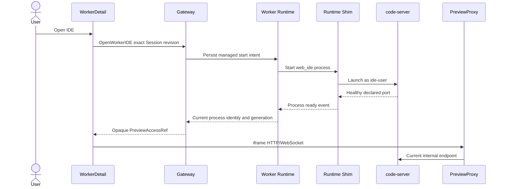

## Context

WorkerDetail will provide a chat-centered Workbench for report and patch review, but advanced users sometimes need the complete editor, terminal and extension experience of the exact Worker environment. A browser IDE is useful only if it shares the WorkerSession WorkingCopy and toolchain while remaining subordinate to Runtime authority.

The accepted platform architecture already defines SessionProcess and PreviewProxy boundaries: an explicit managed process can survive AgentTurn terminality, and Gateway can proxy an exact declared port for the current Runtime generation without publishing a host port. Those capabilities were deferred from the M1 vertical slice and are delivered here for one typed `web_ide` process.

TaskSpec and ContextPack do not grant IDE authority. The authenticated user explicitly opens the IDE. IntegrationEvent records process lifecycle for Eventing & Projection; Trace JSONL records Runtime evidence but does not absorb IDE HTTP bytes or every user terminal command. ArtifactRef remains delivery evidence, and any future Truth generation continues to use governed Trace/Artifact sources rather than browser IDE state.

## Goals / Non-Goals

**Goals:**

- Open a real browser IDE inside the exact live Worker container and WorkingCopy.
- Start it on demand and keep it alive across AgentTurn terminal states.
- Proxy all browser traffic through same-origin Gateway authorization and an exact Runtime endpoint.
- Allow Agent and user edits concurrently in the first version while making possible mixed provenance explicit.
- Prevent IDE availability from destabilizing the Codex Runtime when resource headroom is insufficient.
- Ship a simple preinstalled-extension policy first and retain a path to direct user Open VSX installation.

**Non-Goals:**

- Exposing container or host ports directly.
- Using Microsoft VS Code Server as a hosted service.
- Providing VS Code Remote SSH, Dev Containers or Docker access from the Worker.
- Dynamically switching the IDE between read-only and read-write while AgentTurn state changes.
- Attributing every file byte or terminal command to Agent versus user.
- Automatically restarting an IDE after Runtime generation replacement.
- Allowing Agent code to install IDE extensions on the user's behalf.

## Decisions

### 1. Run a typed IDE SessionProcess in the Worker container

The Worker image includes a pinned code-server build, but the binary does not start during normal Runtime bootstrap. `OpenWorkerIDE` submits an idempotent managed-process intent for process type `web_ide`. Worker Runtime validates the actor, exact WorkerSession revision, current Runtime generation, process uniqueness and capacity before instructing the Shim to start the server as `ide-user`.

The process shares the WorkingCopy, runtime filesystem and toolchain. It does not receive Docker Socket, privileged mode, arbitrary host mounts or remote repository credentials. The Shim owns process group, health and termination.

`code-server` is the primary adapter because it is designed and licensed for self-hosted browser access. OpenVSCode Server remains a fallback adapter behind the same `WebIDEAdapter` contract. Microsoft VS Code Server is excluded because its documentation states that hosting it as a service is not allowed.[^1][^2][^3]

**Alternative considered:** A sidecar IDE sharing only the WorkingCopy volume. Rejected for the first version because terminal and language tooling would not necessarily match the Agent container.

**Alternative considered:** Start IDE for every Runtime. Rejected because it consumes resources even when most tasks only need chat and Artifact review.

### 2. Use asynchronous start and exact process identity

Starting code-server is an external process side effect and does not occur inside a Task or Session database transaction. Worker Runtime first commits SessionProcess start intent and Outbox; the Shim starts the process and emits a generation-fenced ready/failure event. Retries with the same idempotency key return the existing process identity.

Only one `web_ide` SessionProcess may be running per WorkerSession generation. Process state is projected into WorkerDetail with exact process revision and allowed stop/restart/open actions.

### 3. Make PreviewProxy the only browser path

The IDE binds an internal declared port reachable only from Backend on the Runtime network. Docker publishes no host/public port. Gateway validates the current actor, Session, process, Runtime generation, declared port and access expiry before issuing an opaque `PreviewAccessRef`.

The browser loads a same-origin iframe path. PreviewProxy:

- Resolves the endpoint from RuntimeSupervisor rather than client input.
- Proxies HTTP and WebSocket upgrades.
- Strips Switchback cookies, authorization and internal headers before upstream forwarding.
- Does not store IDE bytes in EventCenter, Trace JSONL or ObjectStore.
- Closes tunnels on process/Session terminality, Runtime replacement, revocation or access expiry.

The internal IDE endpoint is not an independent authentication boundary in the single-user profile; network isolation and PreviewProxy authorization are authoritative. A non-local or multi-user profile must re-evaluate origin, CSRF, IDE upstream authentication and disclosure controls.

**Alternative considered:** Give the browser a connection token and direct container URL. Rejected because it leaks topology and bypasses Gateway revocation and generation fencing.

### 4. Embed the IDE in the resizable Workbench

WorkerDetail adds an IDE tab beside Report, Diff and Files. Selecting IDE starts or resolves the process, shows explicit starting/failed states and mounts the iframe only after readiness. The right Workbench pane is resizable and offers temporary full-screen mode so keyboard-heavy IDE use is practical without losing Worker navigation.

Closing the iframe or switching tabs does not stop the process. The user has explicit Stop and Restart controls.

### 5. Allow concurrent Agent and IDE writes with coarse provenance

The first version does not implement dynamic read-only mode. Agent and `ide-user` can concurrently modify the same WorkingCopy, matching a flexible local Coding Agent experience.

Every AgentTurn still persists its WorkerRunStartSnapshot. If a `web_ide` process was running at any point from Turn start through Artifact finalization, resulting report/patch metadata is marked `mixed_origin_possible`. This is intentionally conservative; it does not claim that the user changed a file.

IDE terminal commands are direct user operations. P0 records IDE process start, access, stop and failure, not each command as an Agent Tool Call. Remote publish remains unavailable because the Worker has no GitHub/GitLab credential.

**Alternative considered:** Dynamically make the entire IDE read-only while Agent runs. Rejected because editor UI restrictions do not constrain extensions or terminals, while filesystem ACL/remount approaches add race-prone ownership and open-file semantics.

### 6. Preserve IDE state but not process identity across replacement

IDE settings and extension state live under WorkerSession storage, separate from Agent state and WorkingCopy. The SessionProcess survives source AgentTurn `completed`, `failed`, `cancelled` and `timed_out`.

It stops on:

- Explicit user stop.
- WorkerSession close or expiry.
- Security termination.
- Runtime taint or generation replacement.
- Hard resource exhaustion.

Runtime replacement marks the old IDE process `lost` or `stopped` and closes tunnels. It is not automatically restarted. A later explicit Open IDE creates a new process in the current generation while reusing readable Session IDE settings.

### 7. Keep extension installation staged

Version 1 ships approved extensions in an immutable image directory and disables runtime installation. The writable Session extension directory is unavailable to both Agent and `ide-user`.

A later additive release may enable a Session-persistent extension directory for direct user installation from Open VSX. The system records extension id, version, source and installation time. Agent processes remain unable to write that directory. Microsoft Marketplace is excluded because code-server cannot lawfully provide it under the Marketplace terms.[^4]

### 8. Admit IDE start within the existing Runtime resource envelope

The IDE shares the fixed Worker container cgroup. Before start, Runtime checks current process state and policy-defined CPU, memory and PID headroom. If admission fails, it returns `ide_capacity_unavailable` and leaves Codex, LiteLLM and the WorkerSession unchanged.

Starting the IDE does not create an AgentTurn or deadline. IDE HTTP traffic does not refresh idle time; the explicit Open IDE action may refresh the Session once under the existing preview policy.

## Risks / Trade-offs

- [Concurrent edits produce ambiguous patches] -> Mark possible mixed origin, retain the Turn start snapshot and require human review before remote publication.
- [IDE consumes resources needed by Agent] -> Start on demand, enforce headroom admission and stop on hard resource exhaustion without silently replacing the Runtime.
- [Iframe or WebSocket path rewriting breaks code-server] -> Add adapter-level base-path, HTTP, WebSocket and browser tests against the pinned binary.
- [Preview route leaks Switchback credentials] -> Strip all Switchback auth/internal headers before upstream and test cookie/header isolation.
- [Stale Runtime endpoint remains reachable] -> Resolve by exact generation and process revision for each tunnel; close on replacement/revocation.
- [OpenVSCode fallback behaves differently] -> Keep one `WebIDEAdapter` capability contract and require the same conformance suite.
- [Preinstalled extensions become stale] -> Pin image provenance and update through reviewed Worker image releases.
- [Direct Open VSX installation later adds supply-chain exposure] -> Keep it disabled in v1, isolate the extension directory from Agent and record inventory when enabled.

## Migration Plan

1. Deliver generic SessionProcess identity, lifecycle events and Shim managed-process control without IDE UI.
2. Deliver PreviewProxy HTTP/WebSocket access with a deterministic test process and no host port.
3. Add pinned code-server and approved extensions to the Worker image and verify image provenance.
4. Add `web_ide` adapter, start admission, health and lifecycle projection.
5. Add Workbench iframe, starting/error/full-screen and stop/restart controls.
6. Add mixed-origin metadata at Artifact finalization.
7. Run isolation, resource, lifecycle, WebSocket and browser acceptance suites.
8. Keep the feature disabled by default until the full suite passes on the local Docker profile.

Rollback disables Web IDE creation and stops existing IDE SessionProcesses. Worker chat, Task state, Agent execution, Trace JSONL and ArtifactRef behavior remain available.

## Open Questions

None for version 1. Direct user Open VSX installation is a documented later additive step.

[^1]: Coder. "code-server." https://github.com/coder/code-server

[^2]: Gitpod. "OpenVSCode Server." https://github.com/gitpod-io/openvscode-server

[^3]: Microsoft. "Visual Studio Code Server." https://code.visualstudio.com/docs/remote/vscode-server

[^4]: Coder. "code-server FAQ: Why can't code-server use Microsoft's extension marketplace?" https://coder.com/docs/code-server/FAQ
